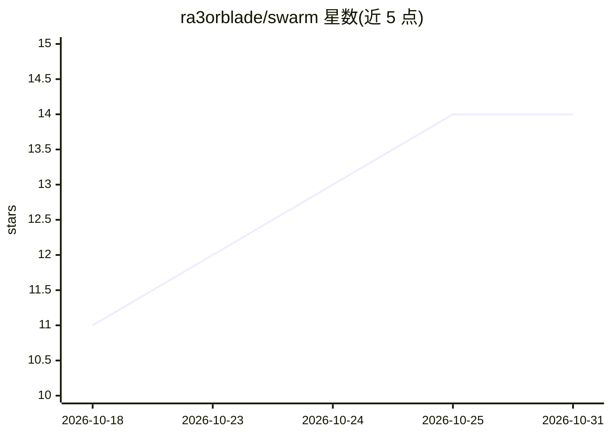

# ra3orblade/swarm

⭐ 14 · TypeScript · Apache-2.0 · 推送 2026-10-26 · [GitHub](https://github.com/ra3orblade/swarm) · [官网](https://getswarm.vercel.app) · 个人维护

**本地优先的 AI agent 开发控制面板：实时观测会话、任务台账与规则管控**

运行于本机的单守护进程，监视机器上 Claude Code、Codex CLI、Gemini CLI、Grok、Aider、opencode 六种 agent 会话：实时工具调用与推理流、token 花费与成本统计；以 Board 台账记录任务认领、git worktree、端口等运行时资源；把 CLAUDE.md 中的约束转为 ask/deny/off 权限决策并记录 incidents；支持验证 gates、声明式工作流、agent 间消息、会话重放与 PR 合并队列。提供 CLI、Web 仪表盘（127.0.0.1:7777）、桌面应用与 MCP 工具。无账号、无遥测、离线可用。

## 筛选速览

| 维度 | 判定 | 备注 |
|---|---|---|
| AI 角色 | `ai-ecosystem` | LLM/agent 周边工具 |
| 许可风险 | `permissive` | Apache-2.0 |
| 部署形态 | `desktop` | 安装包/桌面程序 |
| 模型依赖 | — | README 未给出锁定关系 |
| 硬件要求 | — | 无带数字的原话,不猜 |
| 安装摩擦 | `low` | 无编译、无系统依赖或容器化 |
| 成熟度 | `idea` | |

## 能力要点

- 六个 agent CLI 的零侵入会话观测（读取既有 hooks 与日志）
- 任务认领、隔离 git worktree 与运行时资源的协调台账
- Bash 命令守则转为真实权限决策，ask/deny 记录为 incidents
- 声明式工作流、验证 gates、MCP 工具集与按项目预算

## 适用场景

- 同时跑多个 agent 会话时跟踪分支、成本与 worktree 占用
- 给 Claude Code 的命令执行加守则并留存审批记录
- 按项目统计各模型/agent 的花费与合并成效

## 场景标签

`LLM 可观测性` `多智能体` · 领域:Agent 开发

## 证据(README 行号)

> L23: Run more than one Claude Code session at a time — or a Codex CLI, Gemini, Grok, Aider or opencode run on the side —
> L71: **Multi-agent** — six brands, one ledger: Claude Code via its hooks and transcripts (the full picture — rules, MCP,
> L73: **Zero instrumentation** — it reads the hooks and transcripts the agents already write. Every table is a real data 

## 星数曲线

2026-10-18 11 → 2026-10-31 14（+3）

---
*卡片 v1 · prompt 1.4 · 生成 2026-10-31 · 置信度 high · 依据 README sha `9f22cdb8af8b` · [字段定义](../../DATASET.md)*
