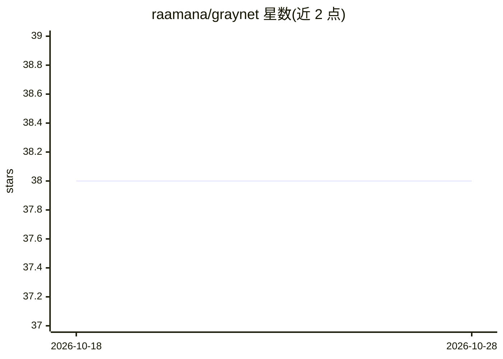

# raamana/graynet

⭐ 38 · Jupyter Notebook · MIT · 推送 2026-04-04 · [GitHub](https://github.com/raamana/graynet) · [官网](https://raamana.github.io/graynet/) · 个人维护

**从结构 MRI 构建单被试脑形态测量网络的科研工具**

Python 库 graynet，读取 FreeSurfer 皮层特征（厚度、曲率）与 CAT12/SPM 体素的灰质密度，按图谱 ROI 生成被试级脑网络的边权重与 ROI 汇总统计，供可视化、统计建模与机器学习使用。2.0 版重写为以 Parquet 为规范存储格式，CLI 分 edges/multiedge/roi-stats/export 子命令，run_metadata.json 记录节点顺序以确定性重建图。注意：新版本不向后兼容旧输出布局，旧格式需用 export 工具转换。

## 筛选速览

| 维度 | 判定 | 备注 |
|---|---|---|
| AI 角色 | `ai-ecosystem` | LLM/agent 周边工具 |
| 许可风险 | `permissive` | MIT |
| 部署形态 | `library` | 以包/库形式分发 |
| 模型依赖 | — | README 未给出锁定关系 |
| 硬件要求 | — | 无带数字的原话,不猜 |
| 安装摩擦 | `low` | 无编译、无系统依赖或容器化 |
| 成熟度 | — | 结构信号不足 |

## 能力要点

- 支持 FreeSurfer 皮层特征与 CAT12/SPM 体素灰质密度两类特征
- 以 Parquet 为规范输出，含可复现重建图的元数据
- CLI 四个子命令：edges/multiedge/roi-stats/export，可导出 GraphML/CSV
- 一行加载 run、一行导出 NetworkX 图，附 2.0 演示 notebook

## 适用场景

- 将被试解剖测量转为 ROI 级边权重做疾病分类或预后建模
- 构建脑-行为关联或老化研究中的单被试脑网络
- 从皮层/体结构特征生成网络汇总统计用于生物标志物开发

## 场景标签

`科研工具` · 领域:学习与行业

## 证据(README 行号)

> L5: graynet builds single-subject morphometric brain networks from structural neuroimaging features such as cortical thi
> L7: It is designed for neuroscience workflows where you want to turn subject-level anatomical measurements into ROI-wise
> L17: - biomarker development

## 星数曲线

2026-10-18 38 → 2026-10-28 38（+0）

---
*卡片 v1 · prompt 1.4 · 生成 2026-10-25 · 置信度 high · 依据 README sha `7df50ad5b3d4` · [字段定义](../../DATASET.md)*
