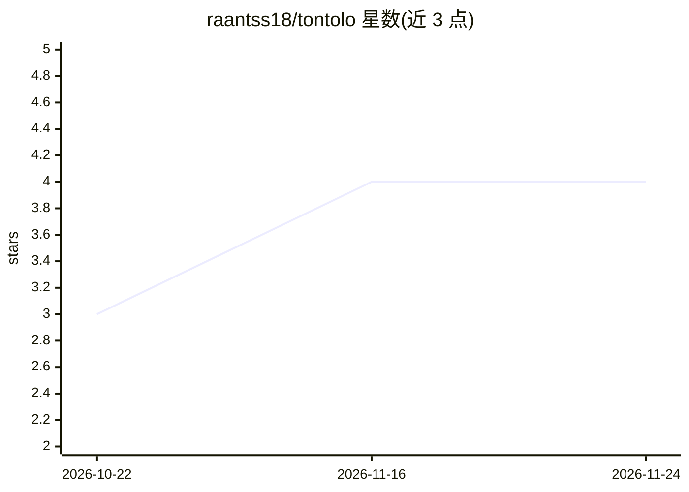

# raantss18/tontolo

⭐ 4 · Python · Apache-2.0 · 推送 2026-10-20 · [GitHub](https://github.com/raantss18/tontolo) · [官网](https://github.com/raantss18/tontolo) · 个人维护

**面向公众的免费 AI 客户端：按请求自动选择免费模型并在额度耗尽时切换**

单一应用整合多个免费 AI 模型：读取请求内容，依据 Artificial Analysis 与 LMArena 公开排行榜为该任务类型挑选评分较高的免费模型，模型饱和或超限时保持会话切换到下一个，恢复后切回。提供 Android APK 与 Linux AppImage，另有 pip 安装的 CLI/服务端，暴露 OpenAI 兼容 API（model="auto"）供现有工具接入；支持自托管 Linux 服务器、本地模型（Ollama/llama.cpp）断网回退、密钥本机加密存储。数据默认从设备直连所选供应商，无中间服务器。

## 筛选速览

| 维度 | 判定 | 备注 |
|---|---|---|
| AI 角色 | `ai-ecosystem` | LLM/agent 周边工具 |
| 许可风险 | `permissive` | Apache-2.0 |
| 部署形态 | `desktop` | 安装包/桌面程序 |
| 模型依赖 | local-ok | 支持本地模型 |
| 硬件要求 | — | 无带数字的原话,不猜 |
| 安装摩擦 | `low` | 无编译、无系统依赖或容器化 |
| 成熟度 | — | 结构信号不足 |

## 能力要点

- 按任务类型自动选择免费模型，饱和时保持会话切换
- OpenAI 兼容 API（model="auto"），本地服务端 http://127.0.0.1:8765/v1
- 支持 Ollama 与 llama.cpp 本地模型作为断网回退
- 目录含 773 个模型（147 免费、20 供应商），45 个模型免注册可用

## 适用场景

- 学生把课程 PDF 转成交互式测验或复习卡片
- 职业用户生成 Word/PDF/PPT 文档并由第二模型复核
- 团队在局域网内自托管服务器共享模型路由
- 离线环境下自动使用本机 Ollama 模型

## 场景标签

`模型网关` `聊天机器人` · 领域:Agent 开发

## 证据(README 行号)

> L66: - **API compatible OpenAI** (`model="auto"`) : vos outils existants profitent du routage
> L93: 2. **Tontolo classe la demande** (code, maths, rédaction, traduction, vision, recherche…) et
> L131: tontolo serve            # API compatible OpenAI sur http://127.0.0.1:8765/v1

## 星数曲线

2026-10-22 3 → 2026-11-24 4（+1）

---
*卡片 v1 · prompt 1.4 · 生成 2026-11-21 · 置信度 high · 依据 README sha `c1919150caeb` · [字段定义](../../DATASET.md)*
