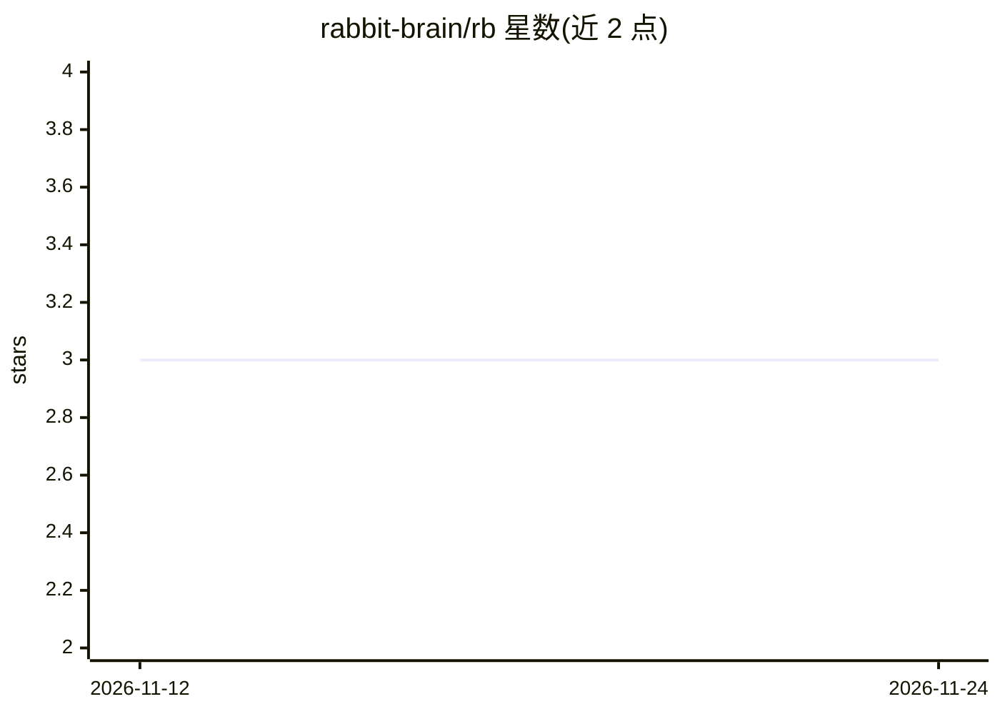

# rabbit-brain/rb

⭐ — · [GitHub]() · 个人维护

**让 AI agent 记录并核验科研实验进度的追踪工具**

Python CLI 工具（rb），供使用 Claude Code/Codex 等 coding agent 做机器学习研究的开发者使用。agent 通过 rb journal run/criterion add/note add 写入研究记录，rb 每次读取时从运行文件重新核对：设置对配置文件、结果对输出文件、运行对 git commit，不采信 agent 的口述，结果不存储而是实时计算；rb context 给新会话提供待解问题与未决事项，最终确认由用户执行 rb confirm。需 Python 3.10+，Apache-2.0。

## 筛选速览

| 维度 | 判定 | 备注 |
|---|---|---|
| AI 角色 | `ai-ecosystem` | LLM/agent 周边工具 |
| 许可风险 | `permissive` | — |
| 部署形态 | `library` | 以包/库形式分发 |
| 模型依赖 | — | README 未给出锁定关系 |
| 硬件要求 | — | 无带数字的原话,不猜 |
| 安装摩擦 | `low` | 无编译、无系统依赖或容器化 |
| 成熟度 | — | 结构信号不足 |

## 能力要点

- 记录核验机制：设置/结果/运行分别对照配置文件、输出文件与 git commit
- 结果每次读取时从运行文件重算，不存储
- rb context 让新 agent 会话继承问题、结果与未决事项
- 决策需用户 rb confirm 才生效

## 适用场景

- 用 Claude Code 做实验时自动留下可核验的研究记录
- 跨会话续接研究：新 agent 从记录恢复上下文
- 防止 agent 谎报实验结果，设置与结果逐项对账

## 场景标签

`科研工具` · 领域:学习与行业

## 证据(README 行号)

> L3: **Know where your research stands.** Your AI agent records what was tried, what the results show, and what's still o
> L46: 1. Your agent writes to the record as it works. It runs experiments through `rb journal run`, sets pass marks with 
> L47: 2. rb checks the record against your repository: each setting against its config file, each result against its outp

## 星数曲线

2026-11-12 3 → 2026-11-24 3（+0）

---
*卡片 v1 · prompt 1.4 · 生成 2026-11-21 · 置信度 high · 依据 README sha `06a7fb2574ca` · [字段定义](../../DATASET.md)*
