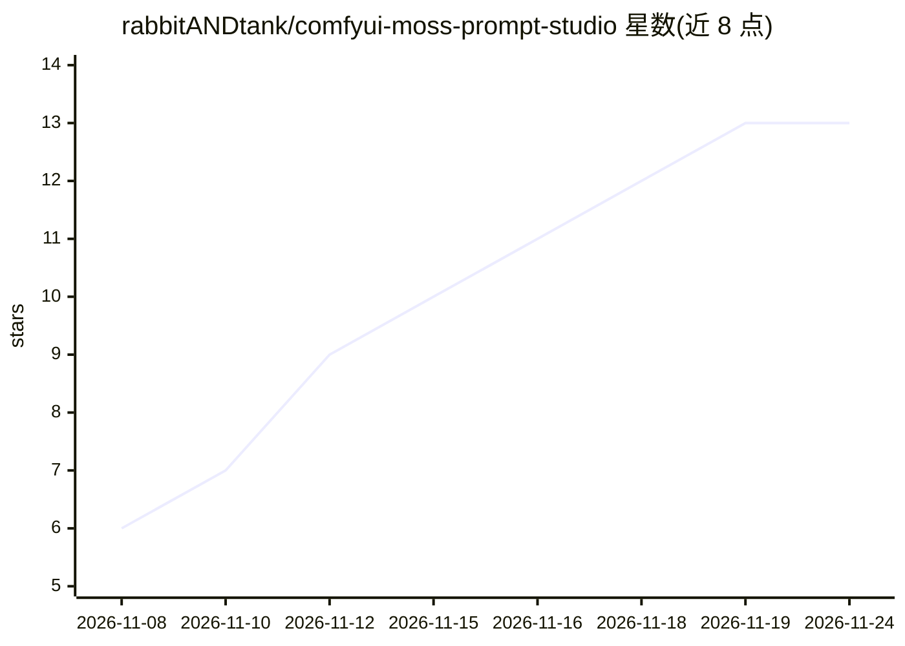

# rabbitANDtank/comfyui-moss-prompt-studio

⭐ 13 · Python · NOASSERTION · 推送 2026-11-11 · [GitHub](https://github.com/rabbitANDtank/comfyui-moss-prompt-studio) · 个人维护 · 中文 README

**ComfyUI 插件：中文提示词可视化编辑、LLM 翻译与 MOSS-Image 编译**

面向 ComfyUI 用户的 MOSS-Image 提示词工作流插件。提供四个节点：Editor 画布（拖拽缩放、图层、模板、多格分镜）、Translator（OpenAI 兼容 LLM 中→英翻译，支持译文缓存复用）、Compiler（按 OpenMOSS 官方 skill 口径编译与校验）、ImageReverse（图片反推中文草稿，默认关闭）。另含 AI 定向改稿（LLM 只产操作清单、审批卡逐条采纳）与姿势/服装参考注入。安装到 ComfyUI/custom_nodes 后重启即可，不新增第三方依赖；支持 MiMo/DeepSeek/MiniMax 及任意 OpenAI 兼容地址（含本地 Ollama/LM Studio）。

## 筛选速览

| 维度 | 判定 | 备注 |
|---|---|---|
| AI 角色 | `ai-ecosystem` | LLM/agent 周边工具 |
| 许可风险 | `none` | NOASSERTION |
| 部署形态 | `None` |  |
| 模型依赖 | local-ok | 支持本地模型 |
| 硬件要求 | — | 无带数字的原话,不猜 |
| 安装摩擦 | `low` | 无编译、无系统依赖或容器化 |
| 成熟度 | — | 结构信号不足 |

## 能力要点

- bbox 可视化画布编辑，内置海报/分镜/三视图等版式模板
- 中→英 LLM 翻译，reuse_translation 复用译文避免重复计费
- 按 OpenMOSS/MOSS-Image 官方 skill 口径编译与严格校验
- AI 定向改稿：LLM 只产操作清单，未被提及元素逐字节不动

## 适用场景

- 把上游 agent 产出的中文草稿在 ComfyUI 里编辑后直接出图
- 从图片反推中文提示词再迭代生成
- 四格漫画/条漫等一张图多分格的排版生成
- 接入本地 Ollama/LM Studio 做翻译与反推

## 场景标签

`提示工程` `图像生成` · 领域:Agent 开发

## 证据(README 行号)

> L7: 把上游 agent 产出的**中文 MOSS-Image 提示词草稿或散文式提示词**，在 ComfyUI 里可视化编辑、翻译成英文、按官方口径编译，直接接原生 MOSS-Image 节点生图。
> L31: 1. **安装**：把本目录放进 `ComfyUI/custom_nodes/`，重启 ComfyUI。也可通过 ComfyUI Manager / Registry 安装：`comfy node install moss-pro
> L151: |Provider|默认地址 / 模型|说明|

## 星数曲线

2026-11-08 6 → 2026-11-24 13（+7）

---
*卡片 v1 · prompt 1.4 · 生成 2026-11-18 · 置信度 high · 依据 README sha `220220ff09da` · [字段定义](../../DATASET.md)*
