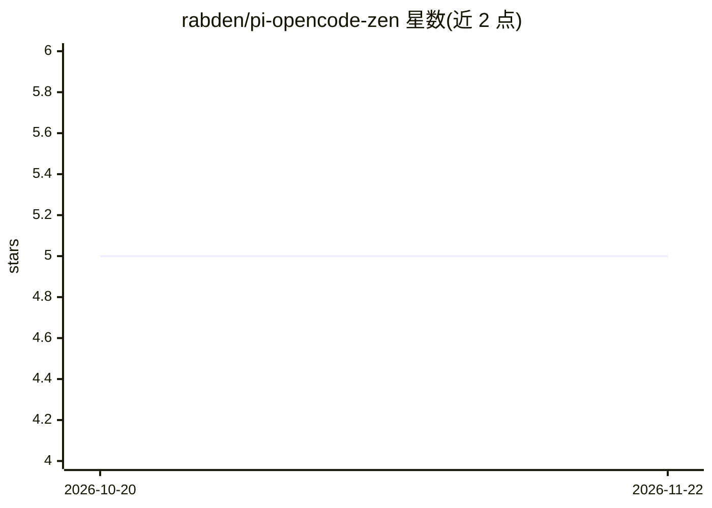

# rabden/pi-opencode-zen

⭐ 5 · TypeScript · MIT · 推送 2026-10-17 · [GitHub](https://github.com/rabden/pi-opencode-zen) · 个人维护

**让 OpenCode Zen 免费模型在 Pi 中使用的扩展**

一个 Pi 扩展包，通过逆向 OpenCode Zen 免费层的请求校验门槛（User-Agent、会话 id、标记 prompt 等），使 `https://opencode.ai/zen/v1` 的免费模型目录在 Pi 之外可用。扩展在每次 pi 启动时从 API 拉取最新模型列表，按模型所在端点（/responses 或 /chat/completions）路由，并在 SSE 响应流中把围栏工具块实时改写为原生 function_call 事件，从而支持 Pi 的真实工具调用与图像输入。门槛参数绑定 OpenCode CLI 1.19.0，服务轮换后需重新捕获。

## 筛选速览

| 维度 | 判定 | 备注 |
|---|---|---|
| AI 角色 | `ai-ecosystem` | LLM/agent 周边工具 |
| 许可风险 | `permissive` | MIT |
| 部署形态 | `None` |  |
| 模型依赖 | — | README 未给出锁定关系 |
| 硬件要求 | — | 无带数字的原话,不猜 |
| 安装摩擦 | `low` | 无编译、无系统依赖或容器化 |
| 成熟度 | — | 结构信号不足 |

## 能力要点

- 每次启动从 API 拉取最新模型列表，未知端点自动在 /responses 与 /chat/completions 间重试
- 通过 globalThis.fetch 补丁在进程内满足门槛校验，免费模型仅需 OPENCODE_API_KEY=public
- SSE 流内将 ```tool 围栏块改写为原生 function_call 事件，支持工具调用与 @image 图像输入
- 提供 PI_ZEN_ALL_MODELS/PI_ZEN_VISION/PI_ZEN_DEBUG 等环境变量配置

## 适用场景

- 在 Pi 中以零成本凭据使用 OpenCode Zen 的免费模型目录
- 让免费模型执行 read/bash/write 等真实工具的多轮任务
- 向多模态免费模型发送图像附件进行分析

## 场景标签

 · 领域:LLM 基础设施/模型接入

## 证据(README 行号)

> L19: This extension reverse-engineers that gate and satisfies it from inside
> L20: Pi — so the free models show up in `/model` like any other provider, and

## 星数曲线



2026-10-20 5 → 2026-11-22 5（+0）


---
*卡片 v1 · prompt 1.4 · 生成 2026-11-21 · 置信度 high · 依据 README sha `381574ba30c7` · [字段定义](../../DATASET.md)*
