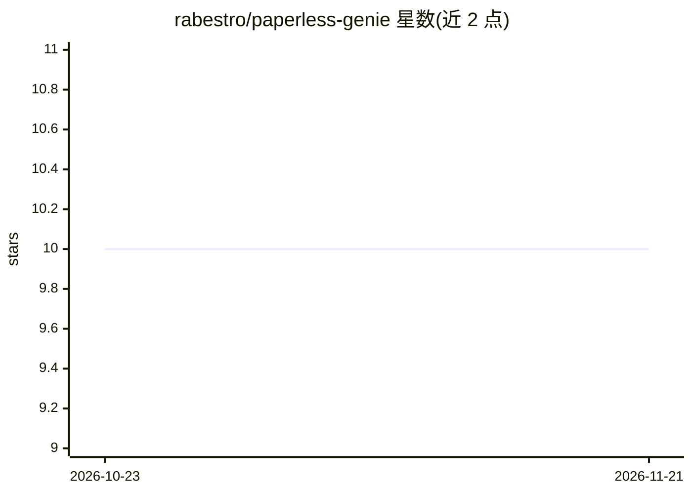

# rabestro/paperless-genie

⭐ 10 · Python · AGPL-3.0 · 推送 2026-11-16 · [GitHub](https://github.com/rabestro/paperless-genie) · [官网](https://jc.id.lv/paperless-genie/) · 个人维护

**通过 Telegram 聊天管理 Paperless-ngx 文档库的 AI 机器人**

一个连接 Paperless-ngx 文档管理系统的 Telegram 机器人，基于 Google Antigravity SDK 构建。用户在 Telegram 中以自然语言检索文档库、上传 PDF/图片由 agent 自动分析并写入元数据，支持总额计算与追问等多轮对话（按用户保留会话记忆）。通过 paperless-mcp 服务器以 MCP 工具操作 Paperless，各 Telegram 用户映射到自己的 API token 实现权限隔离。文档文本会发送至 Google Gemini API，非本地离线方案；需要支持 AVX（x86）或 ARM AES 指令的 CPU。AGPL-3.0 许可，部署修改版网络服务须开源。

## 筛选速览

| 维度 | 判定 | 备注 |
|---|---|---|
| AI 角色 | `ai-native` | 本体是模型或模型工具 |
| 许可风险 | `viral` | AGPL-3.0 |
| 部署形态 | `self-host` | docker 或自建部署 |
| 模型依赖 | — | README 未给出锁定关系 |
| 硬件要求 | — | 无带数字的原话,不猜 |
| 安装摩擦 | `low` | 无编译、无系统依赖或容器化 |
| 成熟度 | — | 结构信号不足 |

## 能力要点

- 自然语言检索文档库，agent 经 MCP 工具调用 Paperless-ngx
- Telegram 内上传文档，agent 自动建议并写入元数据、等待 OCR、写笔记
- 多用户权限隔离：Telegram ID 映射到各用户的 Paperless API token
- 无自有数据库，会话与文件仅在内存中处理

## 适用场景

- 在 Telegram 中直接询问个人文档库内容并追问对比
- 手机拍照/上传 PDF 后自动归档并打好元数据
- 家庭或小团队通过 bot 共管一个 Paperless 实例

## 场景标签

`文档问答` `聊天机器人` · 领域:对话与助手

## 证据(README 行号)

> L16: * **Conversational Search & Query**: Ask questions about your archive in natural language (e.g., *"Find John Doe's 
> L123: * **Documents are sent to Google's Gemini API for analysis.** When you archive

## 星数曲线

2026-10-23 10 → 2026-11-21 10（+0）

---
*卡片 v1 · prompt 1.4 · 生成 2026-11-19 · 置信度 mid · 依据 README sha `c365bd5bf0d1` · [字段定义](../../DATASET.md)*
