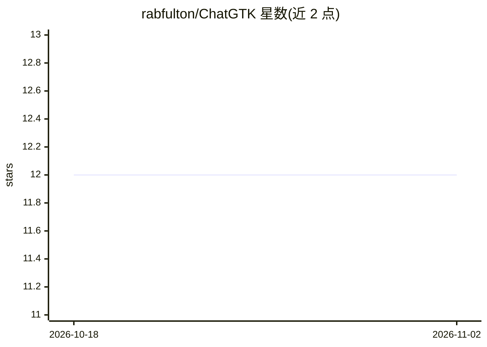

# rabfulton/ChatGTK

⭐ 12 · Python · MIT · 推送 2026-03-30 · [GitHub](https://github.com/rabfulton/ChatGTK) · [官网](https://github.com/rabfulton/ChatGTK) · 个人维护

**Linux 桌面 GTK 多模型 AI 聊天客户端**

基于 GTK3 的 Linux 桌面应用，通过 API 接入 OpenAI、Google Gemini、xAI Grok、Anthropic Claude、Perplexity Sonar，并支持任何 OpenAI 兼容端点（OpenRouter、Together、自托管等）与本地模型服务器（Ollama、LMStudio、LocalAI、faster-whisper、text-generation-webui）。功能覆盖语音输入/输出与实时语音对话、图像生成、语法高亮、LaTeX 公式渲染、工具调用（网页搜索、Wolfram Alpha、音乐控制等）、文档模式（AI 直接编辑文档）、PDF 导出与文档导入转换。需至少一个 API key 或本地服务器；Arch 可从 AUR 安装，Debian 系先装 GTK 运行时再源码安装。

## 筛选速览

| 维度 | 判定 | 备注 |
|---|---|---|
| AI 角色 | `ai-native` | 本体是模型或模型工具 |
| 许可风险 | `permissive` | MIT |
| 部署形态 | `self-host` | docker 或自建部署 |
| 模型依赖 | local-ok | 支持本地模型 |
| 硬件要求 | — | 无带数字的原话,不猜 |
| 安装摩擦 | `low` | 无编译、无系统依赖或容器化 |
| 成熟度 | `idea` | |

## 能力要点

- 多供应商接入：OpenAI/Gemini/Grok/Claude/Perplexity 及任意 OpenAI 兼容端点
- 本地模型服务器集成（Ollama/LMStudio/LocalAI 等），无需 API key
- 文档模式：AI 直接读取并编辑文档，支持撤销
- 语音输入/输出与 OpenAI、xAI 实时语音模型对话

## 适用场景

- 在 Linux 桌面上用统一界面使用多家大模型 API
- 配合 Ollama 等本地服务器离线对话与语音转写
- 让 AI 协助撰写和修改长文档并导出 PDF

## 场景标签

`聊天机器人` `语音 Agent` `图像生成` · 领域:对话与助手

## 证据(README 行号)

> L3: A GTK-based Linux desktop client for OpenAI, Google Gemini, xAI Grok, Perplexity Sonar and Anthropic Claude APIs, fe
> L48: - Multi-provider support for Local, OpenAI, Gemini, xAI, Perplexity, Anthropic and 3rd parties

## 星数曲线

2026-10-18 12 → 2026-11-02 12（+0）

---
*卡片 v1 · prompt 1.4 · 生成 2026-11-01 · 置信度 mid · 依据 README sha `743824f433b0` · [字段定义](../../DATASET.md)*
