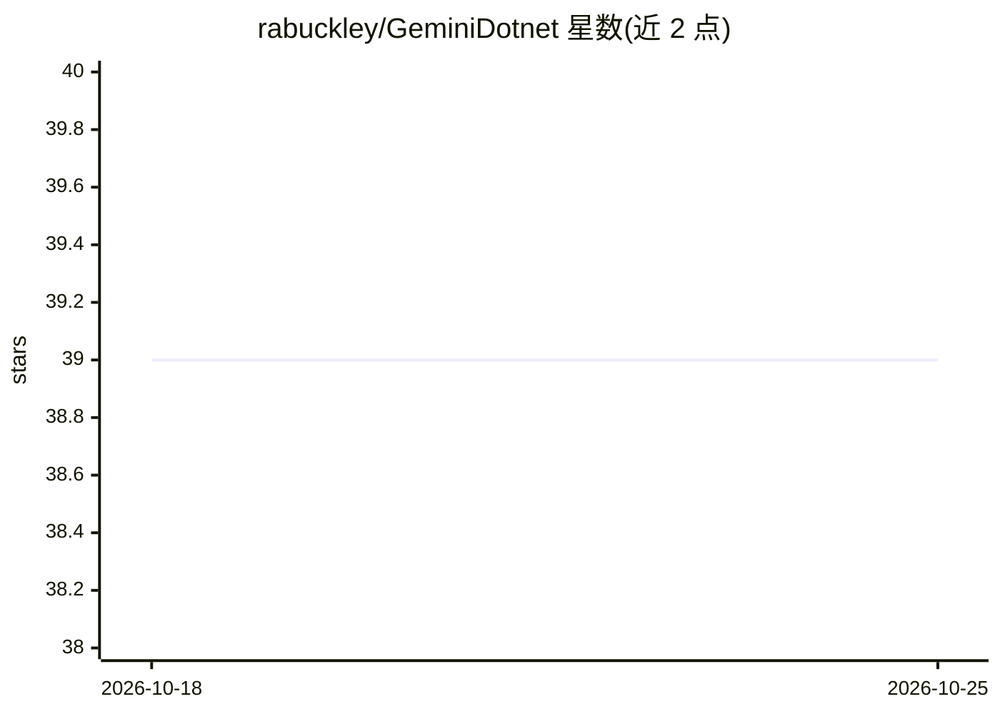

# rabuckley/GeminiDotnet

⭐ 39 · C# · MIT · 推送 2026-10-16 · [GitHub](https://github.com/rabuckley/GeminiDotnet) · 个人维护

**C#/.NET 调用 Google Gemini API 的轻量客户端库**

提供两个 NuGet 包：GeminiDotnet.Extensions.AI 实现 Microsoft.Extensions.AI.Abstractions 接口，允许更换模型提供方而不改代码（推荐入口）；GeminiDotnet 提供对 Gemini API 的直接映射。库采用 System.Text.Json 源生成序列化，兼容 Native AOT，依赖最少。支持流式文本生成、函数调用、代码执行与远程 MCP 服务器接入，对 Gemini 无法满足的 MCP 约束抛出 GeminiMappingException。README 注明 Google 已发布官方 C# 支持可作替代选择。

## 筛选速览

| 维度 | 判定 | 备注 |
|---|---|---|
| AI 角色 | `ai-ecosystem` | LLM/agent 周边工具 |
| 许可风险 | `permissive` | MIT |
| 部署形态 | `None` |  |
| 模型依赖 | — | README 未给出锁定关系 |
| 硬件要求 | — | 无带数字的原话,不猜 |
| 安装摩擦 | `low` | 无编译、无系统依赖或容器化 |
| 成熟度 | — | 结构信号不足 |

## 能力要点

- 实现 Microsoft.Extensions.AI.Abstractions 通用抽象，可替换模型提供方
- System.Text.Json 源生成序列化，Native AOT 兼容，依赖最少
- 支持流式生成、函数调用、代码执行、远程 MCP 服务器
- 对 Gemini 无法满足的请求约束抛出 GeminiMappingException 防止静默降级

## 适用场景

- 在 .NET 应用中接入 Gemini 模型并保持 Microsoft.Extensions.AI 抽象
- 通过流式接口获取增量生成结果
- 让模型调用 .NET 函数或远程 MCP 工具

## 场景标签

`模型网关` · 领域:Agent 开发

## 证据(README 行号)

> L3: GeminiDotnet is a lightweight yet fully-featured library for interacting with Google's Gemini API in modern .NET. Ge
> L5: This respository contains two packages which users can choose from. The recommended entry-point is `GeminiDotnet.Ext

## 星数曲线

2026-10-18 39 → 2026-10-25 39（+0）

---
*卡片 v1 · prompt 1.4 · 生成 2026-10-25 · 置信度 high · 依据 README sha `1e23c464f3fb` · [字段定义](../../DATASET.md)*
