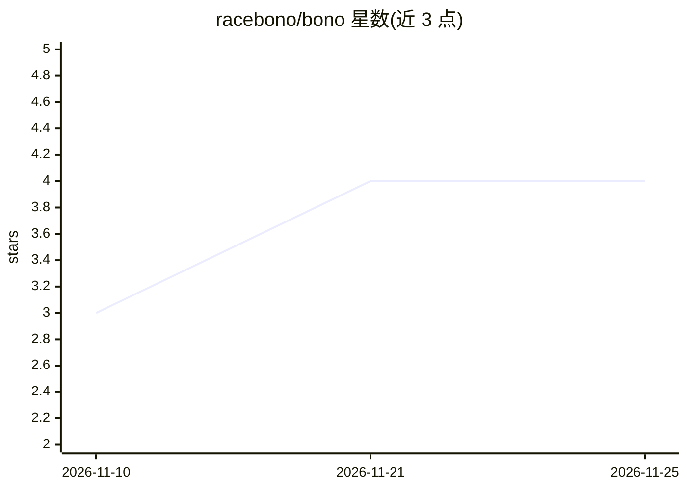

# racebono/bono

⭐ 4 · Rust · MIT · 推送 2026-11-23 · [GitHub](https://github.com/racebono/bono) · [官网](https://racebono.com) · 个人维护

**模拟赛车桌面 AI 赛道工程师与 Spotter，语音问答遥测数据**

用 Rust + SDL3 + egui 构建的桌面应用，读取模拟器实时遥测（油量、轮胎、圈速、附近车辆、比赛排名），用户通过语音或文字提问，获得语音回答。语音识别用本地 Whisper，语音合成用 Piper。自动 Spotter 直接读取遥测播报交通、旗语、车辆警报与天气变化。工程师部分支持 Bono Cloud、Claude、Ollama 及 OpenAI 兼容 API，模型需支持工具调用。Windows 提供打包构建，含自动更新机制；模拟器适配（Le Mans Ultimate、RaceRoom、iRacing）目前仅限 Windows。

## 筛选速览

| 维度 | 判定 | 备注 |
|---|---|---|
| AI 角色 | `ai-enhanced` | 去掉 AI 部分产品仍成立 |
| 许可风险 | `permissive` | MIT |
| 部署形态 | `desktop` | 安装包/桌面程序 |
| 模型依赖 | local-ok | 支持本地模型 |
| 硬件要求 | — | 无带数字的原话,不猜 |
| 安装摩擦 | `high` | 编译与系统依赖俱全 |
| 成熟度 | — | 结构信号不足 |

## 能力要点

- 本地 Whisper 语音识别 + Piper 语音合成的语音问答
- 支持 Bono Cloud、Claude、Ollama、OpenAI 兼容 API，模型需支持工具调用
- 自动 Spotter 播报交通、旗语、天气变化与排位圈速
- 读取 Le Mans Ultimate 插件、RaceRoom 与 iRacing 共享内存遥测

## 适用场景

- 模拟赛车中语音询问剩余油量、轮胎状况与圈速
- 自动播报附近车辆与比赛事件，充当 Spotter
- 使用本地 Ollama 或 llama.cpp 离线运行工程师问答

## 场景标签

`语音合成` `语音识别` `AI 助手` · 领域:对话与助手

## 证据(README 行号)

> L3: Bono is a desktop AI race engineer and spotter for sim racing. Ask questions by voice or text and get spoken answers
> L5: Built in Rust with SDL3 and egui, Bono uses local Whisper speech recognition and Piper text-to-speech. The engineer 
> L9: All current simulator integrations run on Windows:

## 星数曲线

2026-11-10 3 → 2026-11-25 4（+1）

---
*卡片 v1 · prompt 1.4 · 生成 2026-11-21 · 置信度 high · 依据 README sha `109328309a27` · [字段定义](../../DATASET.md)*
