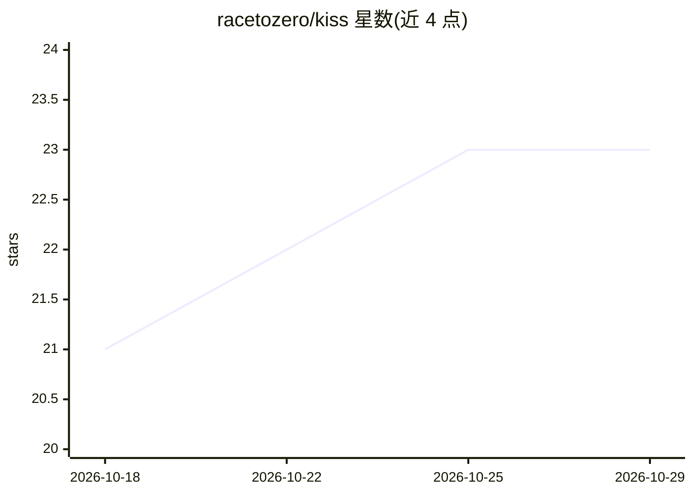

# racetozero/kiss

⭐ 23 · Rust · MIT · 推送 2026-10-10 · [GitHub](https://github.com/racetozero/kiss) · 个人维护

**Rust 编写的终端编码 agent，支持 44 个模型接入**

基于 Pi 工作构建的 Rust 终端编码 agent（harness），用户通过命令行交互驱动模型完成代码任务。内置 44 个 provider（OpenAI Codex/API、Anthropic OAuth/API、Cursor、Bedrock、Databricks、Snowflake、GitHub Copilot 等），并可添加 OpenAI 兼容 provider；支持 1,000+ 目录模型选择、MCP 工具接入、会话持久化（resume/branch/compact/import/export）、定时循环、autoresearch、子 agent 与动态 workflow（最多 1,000 个 agent）。本地运行、不收集遥测。提供 curl 安装脚本与 Homebrew 安装。

## 筛选速览

| 维度 | 判定 | 备注 |
|---|---|---|
| AI 角色 | `ai-ecosystem` | LLM/agent 周边工具 |
| 许可风险 | `permissive` | MIT |
| 部署形态 | `library` | 以包/库形式分发 |
| 模型依赖 | locked-api |  |
| 硬件要求 | — | 无带数字的原话,不猜 |
| 安装摩擦 | `medium` | 含编译或系统依赖之一 |
| 成熟度 | — | 结构信号不足 |

## 能力要点

- 44 个内置 provider，含订阅登录（ChatGPT/Claude/Cursor）与 API key 两种方式
- 循环任务、autoresearch、子 agent 与最多 1,000 agent 的动态 workflow 自动化
- 会话可恢复、分支、压缩、导入导出，并支持续接 Claude Code / Codex / Pi 会话
- 通过 Rust/Python/TypeScript/WASM/JSONL RPC/WebSocket RPC 嵌入，本地运行不收集遥测

## 适用场景

- 在终端里用自己选定的模型完成编码与仓库理解任务
- 用订阅账号（ChatGPT/Claude/Cursor）而非 API key 驱动 agent
- 让 agent 定时循环或并行子 agent 处理长周期任务

## 场景标签

`编码 Agent` · 领域:编码与开发

## 证据(README 行号)

> L11: A ridiculously fast terminal coding agent that keeps the interface simple and gives you
> L14: KISS has 44 built-in providers. These include OpenAI Codex (ChatGPT
> L21: KISS is built in Rust and based on incredible work from

## 星数曲线

2026-10-18 21 → 2026-10-29 23（+2）

---
*卡片 v1 · prompt 1.4 · 生成 2026-10-27 · 置信度 mid · 依据 README sha `5eab0006e41b` · [字段定义](../../DATASET.md)*
