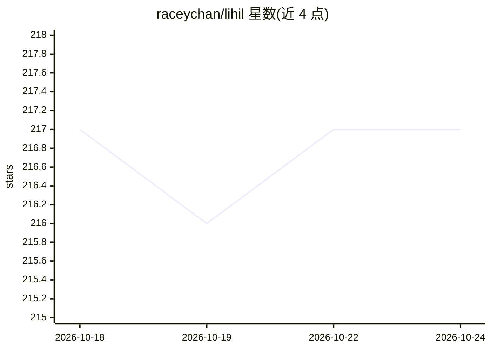

# raceychan/lihil

⭐ 217 · Python · MIT · 推送 2026-06-11 · [GitHub](https://github.com/raceychan/lihil) · [官网](https://www.lihil.cc) · 个人维护

**Python ASGI Web 框架，面向高性能 API 与 WebSocket 开发**

Lihil 是一个 ASGI 兼容的 Python Web 框架，要求 Python>=3.10，通过 pip install "lihil[standard]" 安装（附带 uvicorn）。功能包括基于类型提示的参数解析与校验（msgspec/pydantic/dataclass/TypedDict）、同步/异步依赖注入、WebSocket 路由与类式 Channel/SocketHub、自动生成 OpenAPI 文档、基于 RFC 9457 的结构化错误处理，以及可将外部库包装为内置组件的插件系统（timeout/retry/cache 等）。AI 相关定位：官方称将 AI 作为主要用例，SSE、MCP 等 AI 相关功能在后续版本实现，并提供 LIHIL_COPILOT.md 指导 AI 编码助手使用 Lihil。

## 筛选速览

| 维度 | 判定 | 备注 |
|---|---|---|
| AI 角色 | `ai-enhanced` | 去掉 AI 部分产品仍成立 |
| 许可风险 | `permissive` | MIT |
| 部署形态 | `library` | 以包/库形式分发 |
| 模型依赖 | — | README 未给出锁定关系 |
| 硬件要求 | — | 无带数字的原话,不猜 |
| 安装摩擦 | `low` | 无编译、无系统依赖或容器化 |
| 成熟度 | — | 结构信号不足 |

## 能力要点

- 基于类型提示的参数解析与校验，默认用 msgspec 序列化，一等支持 pydantic
- 类式 Channel/SocketHub：topic 参数注入、协议化回复、bus 广播与任务生命周期管理
- IPlugin 协议插件系统，可将外部库集成为内置功能（timeout/retry/cache 组合）
- RFC 9457 Problem Details 结构化错误处理与自动 OpenAPI schema 生成

## 适用场景

- 构建需要 WebSocket 房间广播与 SSE 流式输出的 API 服务
- 在类型提示驱动的依赖注入下开发企业级 Python Web 应用
- 让 AI 编码助手按 LIHIL_COPILOT.md 规范编写 Lihil 代码

## 场景标签

 · 领域:Web 开发框架

## 证据(README 行号)

> L5: **Lihil** &nbsp;_/ˈliːhaɪl/_ — a **performant**, **productive**, and **professional** web framework with a vision:
> L130: - **Strong support for AI featuers**:

## 星数曲线

2026-10-18 217 → 2026-10-24 217（+0）

---
*卡片 v1 · prompt 1.4 · 生成 2026-10-22 · 置信度 high · 依据 README sha `549884fe6f10` · [字段定义](../../DATASET.md)*
