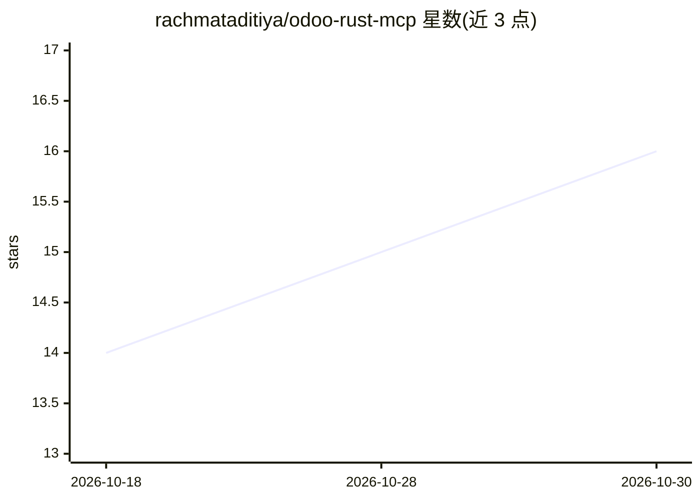

# rachmataditiya/odoo-rust-mcp

⭐ 16 · Rust · MIT · 推送 2026-10-25 · [GitHub](https://github.com/rachmataditiya/odoo-rust-mcp) · [官网](https://github.com/rachmataditiya/odoo-rust-mcp) · 个人维护

**Rust 实现的 Odoo ERP MCP 服务器，供 MCP 客户端访问 Odoo**

Rust 编写的 Model Context Protocol 服务器，连接 Odoo ERP 实例：支持 Odoo 19+ 的 JSON-2 External API（API key 认证）与 Odoo 14-18 的 JSON-RPC（用户名/密码认证），覆盖 stdio、Streamable HTTP、SSE、WebSocket 四种 MCP 传输方式，支持多实例配置与元数据缓存。面向开发者与使用 Cursor、Claude Desktop 等 MCP 客户端的用户。工具、提示词、服务器元数据通过 tools.json/prompts.json/server.json 声明式定义并热重载，无需重新编译；提供 3008 端口的 Web 配置界面、健康检查与配置校验命令。可通过 Homebrew、APT、二进制、Docker 与 Helm 安装。

## 筛选速览

| 维度 | 判定 | 备注 |
|---|---|---|
| AI 角色 | `ai-ecosystem` | LLM/agent 周边工具 |
| 许可风险 | `permissive` | MIT |
| 部署形态 | `desktop` | 安装包/桌面程序 |
| 模型依赖 | — | README 未给出锁定关系 |
| 硬件要求 | — | 无带数字的原话,不猜 |
| 安装摩擦 | `low` | 无编译、无系统依赖或容器化 |
| 成熟度 | — | 结构信号不足 |

## 能力要点

- 支持 Odoo 19+（JSON-2 API key）与 Odoo <19（JSON-RPC 用户名/密码）双认证模式
- stdio / Streamable HTTP / SSE / WebSocket 四种 MCP 传输方式
- tools/prompts/server 均由 JSON 声明式定义，文件变更自动热重载
- 3008 端口 Web 配置界面，含认证管理、JSON 校验与 REST API

## 适用场景

- 在 Cursor 或 Claude Desktop 中通过 MCP 直接操作 Odoo 数据与模型
- 需要多 Odoo 实例（生产/测试）统一接入的场景
- 通过配置文件将访问限制为只读或按环境变量条件启用工具

## 场景标签

 · 领域:MCP/ERP 集成

## 证据(README 行号)

> L16: Rust implementation of an **Odoo MCP server** (Model Context Protocol), supporting:
> L22: - MCP over **stdio** (Cursor / Claude Desktop style)

## 星数曲线

2026-10-18 14 → 2026-10-30 16（+2）

---
*卡片 v1 · prompt 1.4 · 生成 2026-10-30 · 置信度 high · 依据 README sha `c80a988a3a6c` · [字段定义](../../DATASET.md)*
