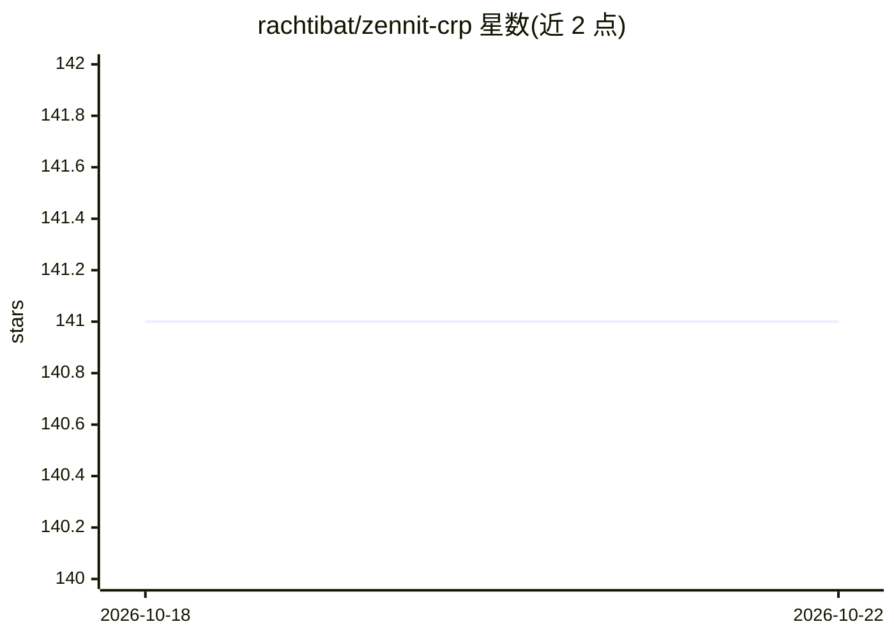

# rachtibat/zennit-crp

⭐ 141 · Jupyter Notebook · NOASSERTION · 推送 2026-01-14 · [GitHub](https://github.com/rachtibat/zennit-crp) · [官网](https://www.nature.com/articles/s42256-023-00711-8) · 组织维护

**PyTorch 神经网络可解释性库：概念相关性传播与相关性最大化**

基于 zennit 构建的开源 PyTorch 神经网络解释工具库，面向研究与开发者。提供 Concept Relevance Propagation（CRP）方法，通过条件反向传播与相关性流掩码，将混合的归因流拆解为各概念的条件相关性图，回答模型依据什么特征做出预测；并引入 Relevance Maximization（RelMax）作为 Activation Maximization 的替代准则，用于选取代表隐层概念含义的样本。附带 Jupyter notebook 教程。项目自述处于开发中、接口可能变动，文档尚不完整。

## 筛选速览

| 维度 | 判定 | 备注 |
|---|---|---|
| AI 角色 | `ai-native` | 本体是模型或模型工具 |
| 许可风险 | `none` | NOASSERTION |
| 部署形态 | `library` | 以包/库形式分发 |
| 模型依赖 | — | README 未给出锁定关系 |
| 硬件要求 | — | 无带数字的原话,不猜 |
| 安装摩擦 | `low` | 无编译、无系统依赖或容器化 |
| 成熟度 | `idea` | |

## 能力要点

- CRP 通过条件反向传播将归因流按概念拆解
- RelMax 作为 ActMax 替代准则选取概念代表样本
- 提供条件归因与特征可视化两个核心接口
- 附 Jupyter notebook 教程

## 适用场景

- 解释模型预测所依赖的具体概念特征
- 可视化隐层网络单元的含义与用途
- 神经网络可解释性研究方法验证

## 场景标签

 · 领域:机器学习可解释性

## 证据(README 行号)

> L1: An open-source pytorch library for neural network interpretability built on zennit.
> L34: With CRP, we propose a method to disentangle the attribution flows associated with concepts learned by the model vi

## 星数曲线

2026-10-18 141 → 2026-10-22 141（+0）

---
*卡片 v1 · prompt 1.4 · 生成 2026-10-22 · 置信度 high · 依据 README sha `c82955c863db` · [字段定义](../../DATASET.md)*
