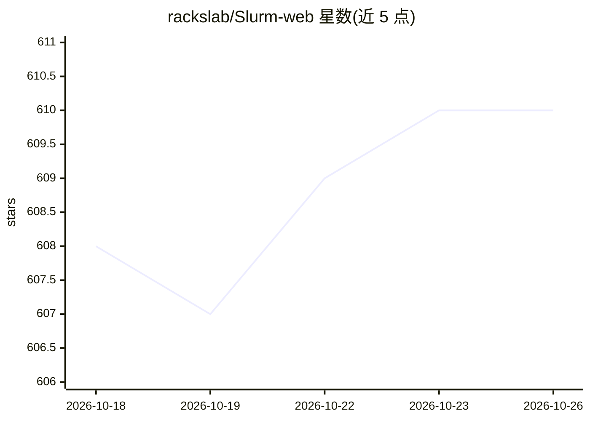

# rackslab/Slurm-web

⭐ 610 · Python · MIT · 推送 2026-10-21 · [GitHub](https://github.com/rackslab/Slurm-web) · [官网](https://slurm-web.com) · 组织维护

**面向 Slurm HPC 与 AI 集群的开源 Web 监控面板**

Slurm-web 是基于 Slurm 的高性能计算集群的 Web 图形界面：提供资源与作业状态的交互式仪表盘、作业实时更新与筛选排序、GPU 资源利用率监控、机架拓扑节点状态可视化、账户树/QOS/预约展示；支持多集群、LDAP/OIDC 认证、RBAC 权限管理与 Prometheus 时序指标集成，可自定义 UI 品牌。面向管理 HPC 超算的组织运维人员，由 Rackslab 公司维护，以容器与 Linux 系统包形式分发，声明稳定可用于生产环境。

## 筛选速览

| 维度 | 判定 | 备注 |
|---|---|---|
| AI 角色 | `ai-ecosystem` | LLM/agent 周边工具 |
| 许可风险 | `permissive` | MIT |
| 部署形态 | `None` |  |
| 模型依赖 | — | README 未给出锁定关系 |
| 硬件要求 | — | 无带数字的原话,不猜 |
| 安装摩擦 | `low` | 无编译、无系统依赖或容器化 |
| 成熟度 | — | 结构信号不足 |

## 能力要点

- 作业与资源状态的实时仪表盘与 GPU 利用率监控
- 机架拓扑的节点状态可视化与多集群支持
- LDAP/OIDC 认证与 RBAC 权限管理
- Prometheus 集成采集并绘制 Slurm 时序指标

## 适用场景

- 组织内通过浏览器跟踪 HPC 集群作业与资源状态
- 按机架拓扑查看节点健康与 GPU 使用情况
- 为多集群环境统一提供带认证与权限控制的监控界面

## 场景标签

 · 领域:HPC/集群运维监控

## 证据(README 行号)

> L10: Slurm-web is an open source web dashboard for Slurm based HPC clusters.
> L33: * GPU resources utilization monitoring

## 星数曲线

2026-10-18 608 → 2026-10-26 610（+2）

---
*卡片 v1 · prompt 1.4 · 生成 2026-10-21 · 置信度 high · 依据 README sha `4f385eff16ee` · [字段定义](../../DATASET.md)*
