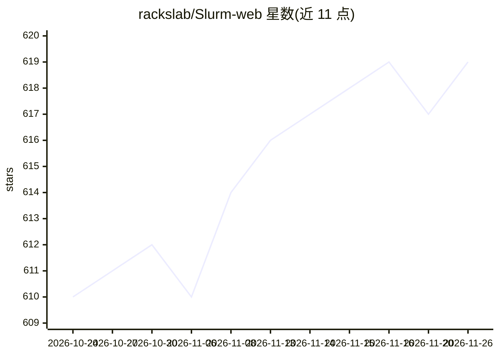

# rackslab/Slurm-web

⭐ 619 · Python · MIT · 推送 2026-11-25 · [GitHub](https://github.com/rackslab/Slurm-web) · [官网](https://slurm-web.com) · 组织维护

**Slurm HPC/AI 集群的 Web 仪表盘**

面向基于 Slurm 的 HPC 集群的开源 Web 仪表盘，在 Slurm 之上提供图形界面，用于在浏览器中跟踪作业、监控超算状态。功能包括交互式资源与作业状态图表、作业即时过滤排序与实时刷新、GPU 资源利用率监控、机架拓扑节点可视化、账户树/QOS/预约展示、多集群支持、LDAP 与 OIDC SSO 认证、RBAC 权限管理、透明缓存，以及集成 Prometheus 采集时序指标。支持自定义 UI 品牌与深色模式。以容器和 Linux 发行版系统包形式安装，由 Rackslab 维护，另提供带 SLA 的 Enterprise/OEM 商业许可。

## 筛选速览

| 维度 | 判定 | 备注 |
|---|---|---|
| AI 角色 | `ai-enhanced` | 去掉 AI 部分产品仍成立 |
| 许可风险 | `permissive` | MIT |
| 部署形态 | `None` |  |
| 模型依赖 | — | README 未给出锁定关系 |
| 硬件要求 | — | 无带数字的原话,不猜 |
| 安装摩擦 | `low` | 无编译、无系统依赖或容器化 |
| 成熟度 | — | 结构信号不足 |

## 能力要点

- 交互式仪表盘展示资源与作业状态，作业实时刷新与过滤排序
- GPU 资源利用率监控与机架拓扑节点可视化
- LDAP/Active Directory 与 OIDC SSO 认证及 RBAC 权限管理
- Prometheus 集成采集 Slurm 时序指标，支持多集群

## 适用场景

- 在浏览器中跟踪和管理 Slurm 集群上的作业
- 监控超算的 GPU 利用率与节点状态
- 为企业内多套集群提供统一 Web 界面与权限管控
- 结合 Prometheus 对 Slurm 指标做时序图表

## 场景标签

 · 领域:HPC/集群管理

## 证据(README 行号)

> L10: Slurm-web is an open source web dashboard for Slurm based HPC clusters.
> L33: * GPU resources utilization monitoring
> L99: the needs of their HPC and AI users and administrators into development

## 星数曲线

2026-10-24 610 → 2026-11-26 619（+9）

---
*卡片 v1 · prompt 1.4 · 生成 2026-11-25 · 置信度 high · 依据 README sha `1050a07b5ed8` · [字段定义](../../DATASET.md)*
