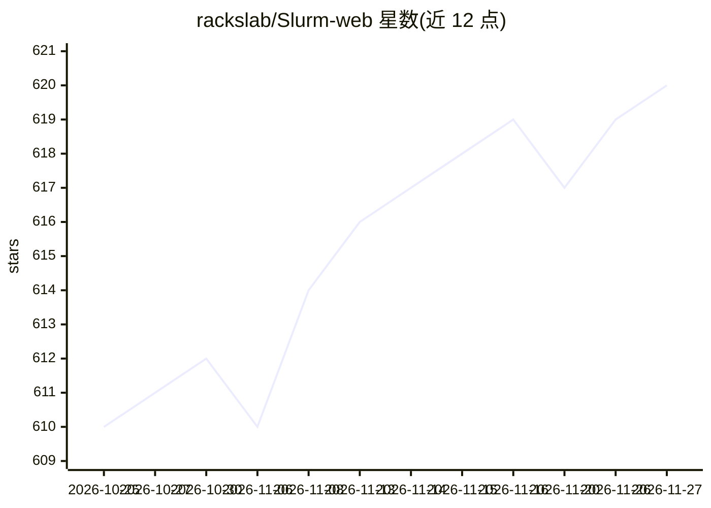

# rackslab/Slurm-web

⭐ 620 · Python · MIT · 推送 2026-11-26 · [GitHub](https://github.com/rackslab/Slurm-web) · [官网](https://slurm-web.com) · 组织维护

**给 Slurm HPC/AI 集群提供网页版作业与资源监控面板**

面向基于 Slurm 的 HPC 集群的网页仪表盘：在 Slurm 之上提供作业追踪、资源状态图表、GPU 利用率监控、节点 2D/3D 机架拓扑可视化、多集群支持、LDAP/OIDC 认证、RBAC 权限管理与 Prometheus 指标集成。提供容器与多数 Linux 发行版的系统包安装方式。由 Rackslab 开发维护，另提供带 SLA 的 Enterprise/OEM 商业支持许可。

## 筛选速览

| 维度 | 判定 | 备注 |
|---|---|---|
| AI 角色 | `ai-enhanced` | 去掉 AI 部分产品仍成立 |
| 许可风险 | `permissive` | MIT |
| 部署形态 | `None` |  |
| 模型依赖 | — | README 未给出锁定关系 |
| 硬件要求 | — | 无带数字的原话,不猜 |
| 安装摩擦 | `low` | 无编译、无系统依赖或容器化 |
| 成熟度 | — | 结构信号不足 |

## 能力要点

- 作业过滤排序与实时状态更新的响应式 Web UI
- GPU 资源利用率监控与节点机架拓扑 2D/3D 可视化
- LDAP/OIDC 认证与 RBAC 权限管理
- Prometheus 集成收集 Slurm 时序指标

## 适用场景

- 在浏览器中监控机构内 HPC 超算的作业与资源状态
- 按机架拓扑查看集群节点状态与 GPU 利用率
- 多集群统一管理与基于 RBAC 的多用户权限控制

## 场景标签

 · 领域:HPC 集群管理/监控

## 证据(README 行号)

> L10: Slurm-web is an open source web dashboard for Slurm based HPC clusters.
> L16: Slurm-web provides a clear graphical user interface with views to track your
> L33: * GPU resources utilization monitoring

## 星数曲线

2026-10-25 610 → 2026-11-27 620（+10）

---
*卡片 v1 · prompt 1.4 · 生成 2026-11-27 · 置信度 high · 依据 README sha `9189f1d35cbb` · [字段定义](../../DATASET.md)*
