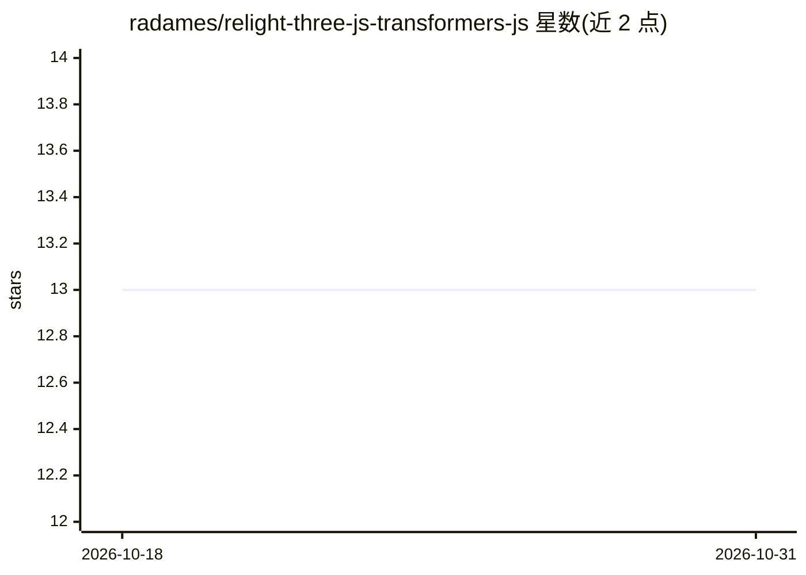

# radames/relight-three-js-transformers-js

⭐ 13 · TypeScript · 推送 2026-08-21 · [GitHub](https://github.com/radames/relight-three-js-transformers-js) · [官网](https://radames.github.io/relight-three-js-transformers-js/) · 个人维护

**浏览器内单目深度估计重打光的 Three.js WebGPU 演示**

将 TypeGPU 的 monocular-light-injection 示例移植为独立的 Three.js（WebGPU + TSL）网页应用：从摄像头或照片输入，用 Transformers.js 在浏览器端运行 Depth Anything V2（small/base/large 可选）做逐像素深度估计，再注入可移动虚拟点光源，实现深度感知的漫反射/高光着色与光线步进软阴影。推理后端支持 webgpu/wasm/WebNN，ONNX Runtime 与渲染器可共享 GPUDevice 以降低深度延迟；限制是需 WebGPU 浏览器（Chrome/Edge 121+），模型首次运行从 HF Hub 下载 25–330 MB。README 注明代码由 Claude Code（Anthropic）生成。

## 筛选速览

| 维度 | 判定 | 备注 |
|---|---|---|
| AI 角色 | `ai-native` | 本体是模型或模型工具 |
| 许可风险 | `none` | — |
| 部署形态 | `library` | 以包/库形式分发 |
| 模型依赖 | — | README 未给出锁定关系 |
| 硬件要求 | — | 无带数字的原话,不猜 |
| 安装摩擦 | `low` | 无编译、无系统依赖或容器化 |
| 成熟度 | — | 结构信号不足 |

## 能力要点

- 浏览器端运行 Depth Anything V2（fp16），WebGPU 后端与渲染共享 GPUDevice，实测降低约 39% 深度延迟
- Three.js WebGPURenderer + TSL 节点着色：时间稳定、AO 计算、32 步光线步进软阴影
- 推理引擎可运行时切换 webgpu / wasm / webnn-gpu / webnn-npu
- 支持实时摄像头与照片输入，lil-gui 面板调节光源、深度分辨率与调试视图

## 适用场景

- 在浏览器里体验照片或摄像头画面的 AI 深度重打光
- 学习 Three.js WebGPU/TSL 与 Transformers.js WebGPU 共享设备的技术方案
- 对比 ONNX Runtime 各执行后端（wasm/WebNN）的浏览器推理表现

## 场景标签

`图像视频处理` · 领域:感知与多模态

## 证据(README 行号)

> L10: take a webcam feed or a photo, estimate per-pixel depth with a neural network in the
> L25: - **Depth inference** — Depth Anything V2

## 星数曲线

2026-10-18 13 → 2026-10-31 13（+0）

---
*卡片 v1 · prompt 1.4 · 生成 2026-10-31 · 置信度 high · 依据 README sha `4dcb0e4c4665` · [字段定义](../../DATASET.md)*
