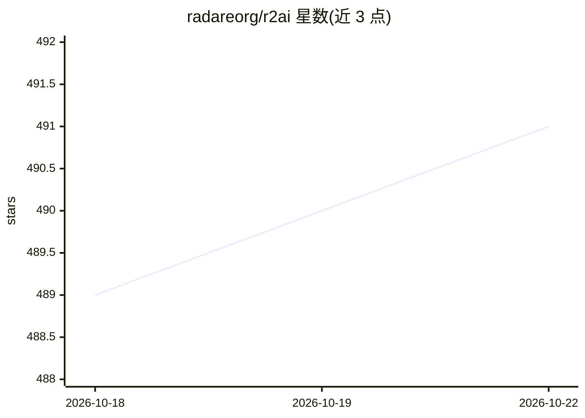

# radareorg/r2ai

⭐ 491 · C · MIT · 推送 2026-10-20 · [GitHub](https://github.com/radareorg/r2ai) · [官网](https://www.radare.org) · 组织维护

**radare2 的 LLM 插件：逆向工程中调用大模型辅助分析**

为 radare2 逆向工程框架提供的两个 LLM 插件：r2ai（原生 AI 插件）与 decai（专注反编译的 r2js 插件）。支持在 r2 提示符或 CLI 的 repl/批处理模式下使用，可配置角色与自定义提示词，支持 ReAct 自动模式通过函数调用解决任务，可接入本地与远程语言模型（ollama、openai、grok、anthropic 等），内置向量数据库对 markdown/代码/文本做 RAG，并可嵌入 r2 命令输出后对其提问。通过 r2pm 安装。

## 筛选速览

| 维度 | 判定 | 备注 |
|---|---|---|
| AI 角色 | `ai-ecosystem` | LLM/agent 周边工具 |
| 许可风险 | `permissive` | MIT |
| 部署形态 | `None` |  |
| 模型依赖 | local-ok | 支持本地模型 |
| 硬件要求 | — | 无带数字的原话,不猜 |
| 安装摩擦 | `low` | 无编译、无系统依赖或容器化 |
| 成熟度 | — | 结构信号不足 |

## 能力要点

- r2ai 原生插件与 decai 反编译专注插件
- 支持本地与远程模型（ollama/openai/grok/anthropic 等）
- ReAct 自动模式经函数调用解决任务
- 原生向量数据库支持 markdown/代码/文本 RAG

## 适用场景

- 逆向分析时让 LLM 解释当前函数或识别使用的设备
- 对 r2 命令输出提问以辅助恶意软件分析
- 反编译代码的 LLM 辅助解读

## 场景标签

 · 领域:逆向工程/安全研究

## 证据(README 行号)

> L17: * **r2ai** - native AI plugin for radare2
> L34: * Use local and remote language models (ollama, openai, grok, anthropic, ..)

## 星数曲线

2026-10-18 489 → 2026-10-22 491（+2）

---
*卡片 v1 · prompt 1.4 · 生成 2026-10-21 · 置信度 high · 依据 README sha `62198e70d5ef` · [字段定义](../../DATASET.md)*
