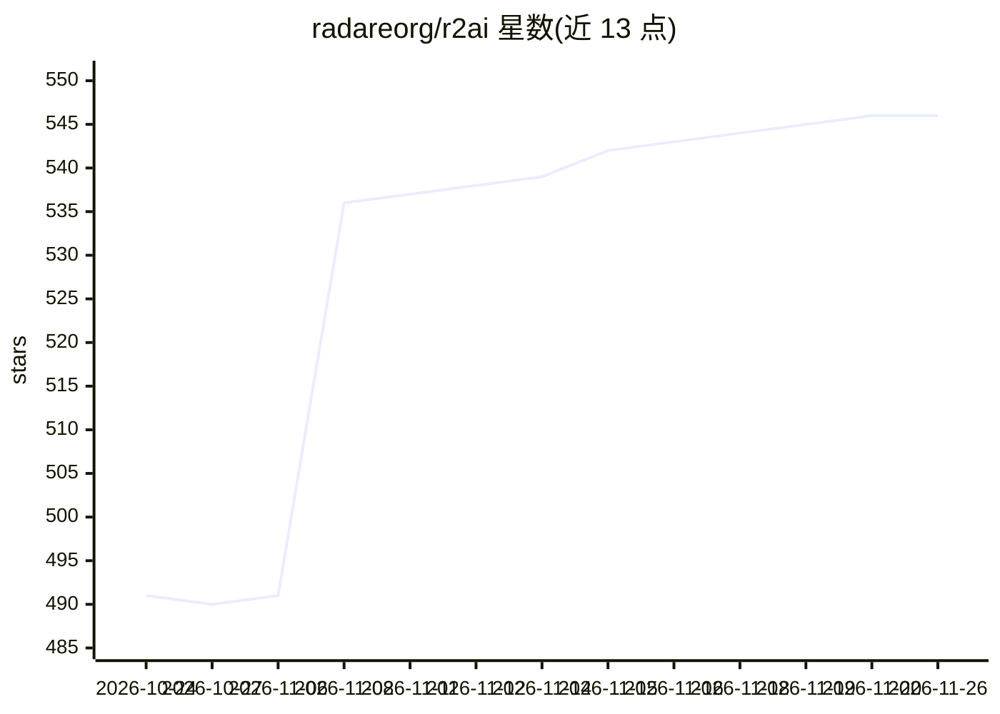

# radareorg/r2ai

⭐ 546 · C · MIT · 推送 2026-11-06 · [GitHub](https://github.com/radareorg/r2ai) · [官网](https://www.radare.org) · 组织维护

**radare2 的 LLM 逆向分析插件：解释函数与反编译**

radareorg 维护的 radare2 逆向工程 AI 插件集合，包含两个插件：r2ai 原生插件与侧重反编译的 decai（r2js）。功能包括自定义角色与提示词、r2pipe 脚本化、REPL/批处理模式、ReAct 自动任务求解（函数调用）、本地与远程语言模型接入、内置向量数据库的 RAG，以及将 r2 命令输出嵌入后回答问题。推荐通过 r2pm 安装，API key 经环境变量或配置文件设置。

## 筛选速览

| 维度 | 判定 | 备注 |
|---|---|---|
| AI 角色 | `ai-native` | 本体是模型或模型工具 |
| 许可风险 | `permissive` | MIT |
| 部署形态 | `None` |  |
| 模型依赖 | local-ok | 支持本地模型 |
| 硬件要求 | — | 无带数字的原话,不猜 |
| 安装摩擦 | `low` | 无编译、无系统依赖或容器化 |
| 成熟度 | — | 结构信号不足 |

## 能力要点

- r2ai 与 decai 两个 radare2 插件，后者专注反编译
- 支持本地与远程语言模型（ollama、openai、grok、anthropic 等）
- ReAct 自动模式通过函数调用解决任务
- 内置向量数据库，支持 markdown/代码/文本文件的 RAG

## 适用场景

- 逆向分析时让 AI 解释当前函数或设备用途
- 对恶意软件做反编译与去混淆分析
- 将 r2 命令输出嵌入并向模型提问

## 场景标签

`RAG` `编码 Agent` · 领域:编码与开发

## 证据(README 行号)

> L17: * **r2ai** - native AI plugin for radare2
> L34: * Use local and remote language models (ollama, openai, grok, anthropic, ..)

## 星数曲线

2026-10-24 491 → 2026-11-26 546（+55）

---
*卡片 v1 · prompt 1.4 · 生成 2026-11-25 · 置信度 high · 依据 README sha `ae02c05e7120` · [字段定义](../../DATASET.md)*
