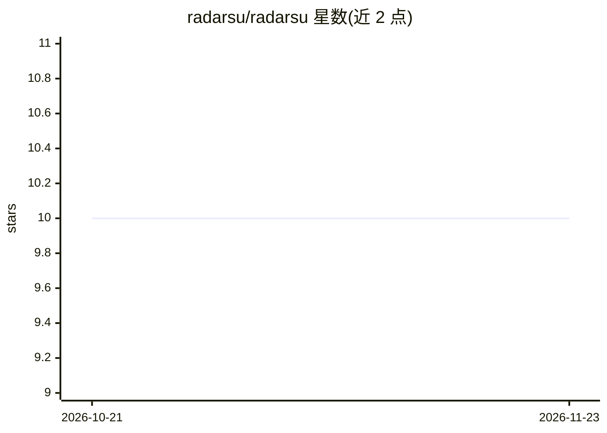

# radarsu/radarsu

⭐ 10 · 推送 2026-02-17 · [GitHub](https://github.com/radarsu/radarsu) · [官网](https://radarsu.com) · 个人维护

**全栈 TypeScript 工程师的个人主页与项目索引**

这是开发者 Artur Kurowski（radarsu）的 GitHub 个人主页 README，非软件产品：介绍其全栈 TypeScript 技术方向（Node.js/NestJS 后端、Angular 前端、CI/CD 与 Docker 基础设施），并列表展示其库与工具项目，包括运行时动态导入 ts-import、波兰标识符校验 validate-polish、JSON-RPC WebSocket 客户端 rpc-websocket-client、P2P 发布发现协议 atlas-protocol 等。页面提供个人网站与 GitHub 联系方式，不含安装或运行说明。

## 筛选速览

| 维度 | 判定 | 备注 |
|---|---|---|
| AI 角色 | `ai-knowledge` | 知识聚合/清单类 |
| 许可风险 | `none` | — |
| 部署形态 | `None` |  |
| 模型依赖 | — | README 未给出锁定关系 |
| 硬件要求 | — | 无带数字的原话,不猜 |
| 安装摩擦 | `low` | 无编译、无系统依赖或容器化 |
| 成熟度 | — | 结构信号不足 |

## 能力要点

- 列出库与工具项目：ts-import、validate-polish、rpc-websocket-client、options-defaults、kill-process-on-port
- 展示去中心化 P2P 协议项目 atlas-protocol
- 介绍个人技术栈：Node.js、NestJS、Angular、Docker、GitHub Actions

## 适用场景

- 了解该开发者的技术方向与代表项目
- 查找其维护的 TypeScript 库与 P2P 协议仓库入口

## 场景标签

 · 领域:开发者个人主页

## 证据(README 行号)

> L1: # Hi, I'm Artur Kurowski 👋
> L9: **Full-stack TypeScript engineer** focused on scalable backend systems, developer tooling, and decentralized archite

## 星数曲线

2026-10-21 10 → 2026-11-23 10（+0）

---
*卡片 v1 · prompt 1.4 · 生成 2026-11-19 · 置信度 low · 依据 README sha `d8c5b80e9a33` · [字段定义](../../DATASET.md)*
