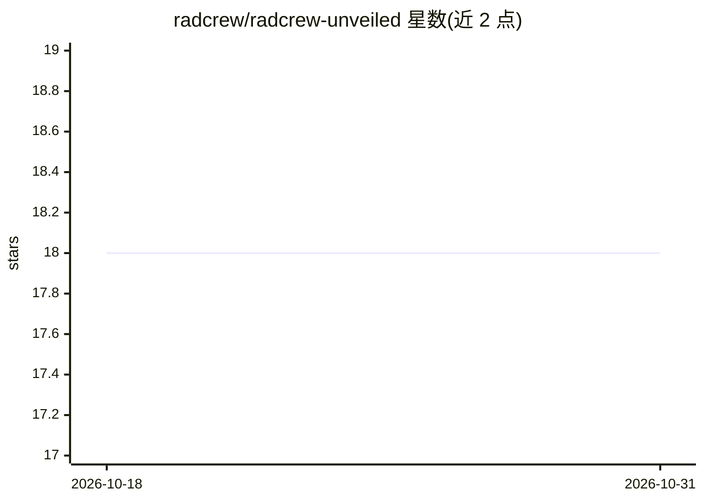

# radcrew/radcrew-unveiled

⭐ 18 · TypeScript · MIT · 推送 2026-08-08 · [GitHub](https://github.com/radcrew/radcrew-unveiled) · [官网](https://radcrew.org) · 组织维护

**RadCrew.org 官网与 LLM 驱动的 FAQ 聊天机器人**

Monorepo 项目：前端为 Vite React 静态站点，后端为 FastAPI + Uvicorn 的 FAQ 聊天 API。聊天流程：浏览器 POST /chat 读取 SSE 流，先经 Guardrails 审查，再由路由分发至反馈提交或 RAG 路径；RAG 从站点文案与可选 GitHub Markdown 检索片段，由配置的模型服务商流式生成回答——设置 OPENROUTER_API_KEY 时用 OpenRouter，否则设置 HF_TOKEN 时用 Hugging Face。弱检索时返回含联系指引的安全兜底回复。主题标签提及 QLoRA 微调与 LangGraph。面向熟悉 Yarn/Node 与 Python 的开发者部署运行。

## 筛选速览

| 维度 | 判定 | 备注 |
|---|---|---|
| AI 角色 | `ai-native` | 本体是模型或模型工具 |
| 许可风险 | `permissive` | MIT |
| 部署形态 | `library` | 以包/库形式分发 |
| 模型依赖 | locked-api |  |
| 硬件要求 | — | 无带数字的原话,不猜 |
| 安装摩擦 | `low` | 无编译、无系统依赖或容器化 |
| 成熟度 | — | 结构信号不足 |

## 能力要点

- Guardrails 审查 + 路由分发（反馈/RAG）的聊天流程
- RAG 检索站点文案与可选 GitHub Markdown
- OpenRouter / Hugging Face 双服务商切换（按环境变量）
- SSE 流式回答与弱检索安全兜底

## 适用场景

- 为组织官网部署一个基于自有内容的 FAQ 聊天机器人
- 在无强检索命中时引导用户转向人工联系方式

## 场景标签

`聊天机器人` `RAG` · 领域:对话与助手

## 证据(README 行号)

> L3: Monorepo: Vite React site (`frontend`) and FAQ chatbot API (`backend`, FastAPI + Uvicorn).
> L43: - The configured provider streams a grounded answer: **OpenRouter** when `OPENROUTER_API_KEY` is set, otherwise **H

## 星数曲线

2026-10-18 18 → 2026-10-31 18（+0）

---
*卡片 v1 · prompt 1.4 · 生成 2026-10-29 · 置信度 mid · 依据 README sha `238941e8d263` · [字段定义](../../DATASET.md)*
