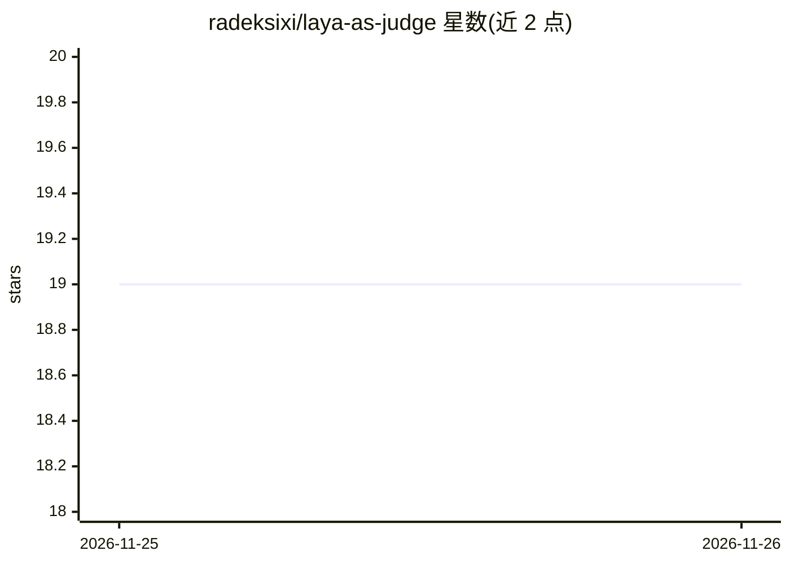

# radeksixi/laya-as-judge

⭐ 19 · Python · Apache-2.0 · 推送 2026-11-25 · [GitHub](https://github.com/radeksixi/laya-as-judge) · [官网](https://pypi.org/project/laya-as-judge/) · 个人维护

**给 AI 应用与 agent 提供零输出 token 的决策/评判/治理 API**

提供 Python SDK、CLI（laya-judge）、FastAPI HTTP 服务、MCP stdio 服务器与 GitHub Action，暴露三种模式：Decision API（类型化决策）、Judge API（6 种评测预设与自定义规则）、Hybrid 治理门（COMMIT/FALLBACK/ABSTAIN/BLOCK 四路判定）。可本地运行于预置硬件档位（edge-6gb、rtx-16gb 等），也可选择性地将不确定/多模态请求升级至 Gemini 云端。面向需要 air-gapped 部署与审计追踪的企业及独立开发者。

## 筛选速览

| 维度 | 判定 | 备注 |
|---|---|---|
| AI 角色 | `ai-ecosystem` | LLM/agent 周边工具 |
| 许可风险 | `permissive` | Apache-2.0 |
| 部署形态 | `library` | 以包/库形式分发 |
| 模型依赖 | local-ok | 支持本地模型 |
| 硬件要求 | `gpu-8g` | |
| 安装摩擦 | `medium` | 含编译或系统依赖之一 |
| 成熟度 | — | 结构信号不足 |

## 能力要点

- 三种统一 API 模式：Decision / Judge / Hybrid 治理门（4 路 ActionGate 判定）
- 提供 OpenAI /v1/moderations、Cohere/vLLM /v1/rerank 等 drop-in 端点
- FastMCP 与 LangGraph 中间件（LayaToolGateMiddleware、LayaJudgedGateNode），5 行代码接入 agent
- 预置本地硬件档位（edge-6gb 至 workstation-24gb）与模拟器模式（无模型下载）

## 适用场景

- 为 agent 工具调用加护栏，对高风险动作做提交/拦截判定
- 替代云端 API 做本地 LLM 输出评测与 RAG 忠实度打分
- 在 air-gapped 合规环境（EU AI Act / DORA）做带审计追踪的决策服务
- 在 CI 中闭环 red-team 发现的修复验证

## 场景标签

`模型评测` · 领域:评测与运维

## 证据(README 行号)

> L65: Software rarely needs an autoregressive LLM writing 250 tokens of prose just to route a ticket, block a prompt inje
> L26: - **For AI Engineering Leads (5-Line Agent Integration):** Native **FastMCP** (`LayaToolGateMiddleware`) and **Lang
> L24: - **For CISOs & AI Risk (Fail-Closed Tool-Call Firewall):** Air-gapped on-prem execution (`$0` cloud egress, FINMA 

## 星数曲线

2026-11-25 19 → 2026-11-26 19（+0）

---
*卡片 v1 · prompt 1.4 · 生成 2026-11-24 · 置信度 high · 依据 README sha `d4f1e9d3618b` · [字段定义](../../DATASET.md)*
