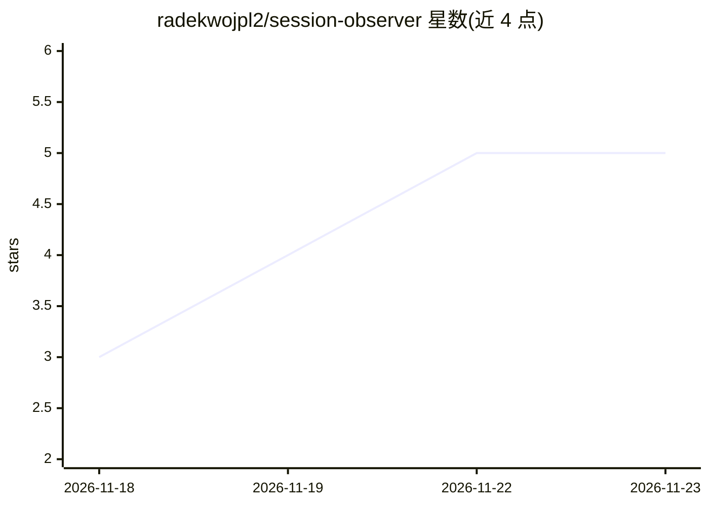

# radekwojpl2/session-observer

⭐ 5 · JavaScript · MIT · 推送 2026-11-22 · [GitHub](https://github.com/radekwojpl2/session-observer) · 个人维护 · 中文 README

**Claude Code 用户的会话实时可视化仪表盘插件**

以 Claude Code 插件形式运行的本地观测面板：通过 33 个异步钩子捕获会话事件写入 JSONL 日志，服务器经 SSE 推送到本地浏览器页面，展示提示、工具调用（含耗时）、子代理分支、MCP 调用、权限请求、上下文压缩、模型切换与逐会话 token 用量等；提供路线图、聊天、上下文全文等视图，支持 10 种界面语言。纯 Node.js（18+）零依赖实现，服务只绑定 127.0.0.1，不联网上传数据。

## 筛选速览

| 维度 | 判定 | 备注 |
|---|---|---|
| AI 角色 | `ai-ecosystem` | LLM/agent 周边工具 |
| 许可风险 | `permissive` | MIT |
| 部署形态 | `desktop` | 安装包/桌面程序 |
| 模型依赖 | — | README 未给出锁定关系 |
| 硬件要求 | — | 无带数字的原话,不猜 |
| 安装摩擦 | `low` | 无编译、无系统依赖或容器化 |
| 成熟度 | — | 结构信号不足 |

## 能力要点

- 33 个异步钩子捕获 Claude Code 全部钩子事件，零依赖纯 Node.js 实现
- 路线视图以地铁线形式呈现 turn 与子代理的分支合并
- Context 视图从 transcript 完整还原系统提示、指令文件与每条消息
- 服务仅绑定 127.0.0.1，事件先落 JSONL，面板关闭不丢数据

## 适用场景

- 调试或复盘 Claude Code 会话中每一步工具调用与返回
- 观察子代理并行任务的分支与执行路径
- 查看会话上下文占用与逐 turn 的 token 用量

## 场景标签

`LLM 可观测性` · 领域:评测与运维

## 证据(README 行号)

> L3: # Session Observer — a Claude Code plugin
> L90: Claude Code ──(33 async hooks)──▶ scripts/hook.js ──▶ ~/.claude/session-observer/events.jsonl

## 星数曲线

2026-11-18 3 → 2026-11-23 5（+2）

---
*卡片 v1 · prompt 1.4 · 生成 2026-11-21 · 置信度 mid · 依据 README sha `3b97bc424c1a` · [字段定义](../../DATASET.md)*
