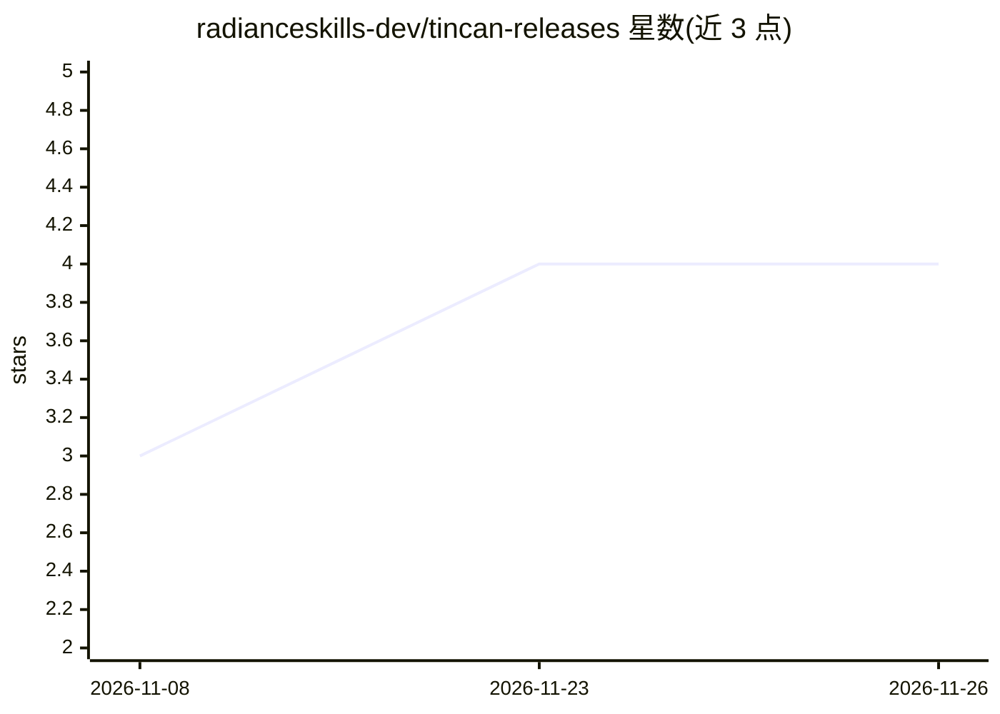

# radianceskills-dev/tincan-releases

⭐ 4 · 推送 2026-11-22 · [GitHub](https://github.com/radianceskills-dev/tincan-releases) · [官网](https://tincan.rdskills-lab.com) · 个人维护

**Android 原生 AI Agent 工作台：本地沙盒、SSH、MCP 与离线模型**

面向 Android 的原生 AI Agent 与编码工作台应用：内置 proot 实现的设备端 Alpine Linux 沙盒（可执行 shell/Python/Node 脚本）、多主机 SSH 客户端与后台持久任务、MCP 客户端（HTTP/SSE+OAuth）及 skills.sh 技能安装。模型接入支持 ChatGPT/Antigravity/Puter/OpenRouter OAuth 登录、BYOK 自定义端点，以及本地 llama.cpp 量化 GGUF 推理与离线 Whisper 语音转写；切换 OAuth 账号可在同一线程恢复对话。提供 Chat/Plan/Build/Pro 五阶段自我批判等模式、两层持久记忆、语义 RAG 检索与 cron 定时任务。仅以 APK 分发，需 Android 7.0+ ARM64。

## 筛选速览

| 维度 | 判定 | 备注 |
|---|---|---|
| AI 角色 | `ai-native` | 本体是模型或模型工具 |
| 许可风险 | `none` | — |
| 部署形态 | `desktop` | 安装包/桌面程序 |
| 模型依赖 | local-ok | 支持本地模型 |
| 硬件要求 | — | 无带数字的原话,不猜 |
| 安装摩擦 | `low` | 无编译、无系统依赖或容器化 |
| 成熟度 | — | 结构信号不足 |

## 能力要点

- 设备端 Alpine Linux 沙盒（proot）与多主机 SSH 远程执行
- 本地 llama.cpp（GGUF+mmproj 视觉）与离线 Whisper 语音转写
- MCP 客户端（HTTP/SSE+OAuth）与 skills.sh 技能安装
- OAuth 账号中途切换且不丢失对话上下文

## 适用场景

- 在手机上通过自然语言执行 shell 脚本和管理远程服务器
- 免费额度用尽时切换 OAuth 账号继续同一对话
- 无网络环境下用本地 GGUF 模型和离线语音输入
- 把 ChatGPT/Claude 历史导入后继续移动端工作

## 场景标签

`编码 Agent` `AI 助手` · 领域:编码与开发

## 证据(README 行号)

> L5: **Run a local Alpine Linux sandbox, manage remote SSH servers, connect MCP tools, run offline `.gguf` & Whisper mode
> L29: **TinCan (`com.shunmin.tincan`) is a Claude Code-level agentic workspace built natively for Android:**
> L53: - **On-Device Offline LLM Inference (`llama.cpp`):** Run quantized `.gguf` chat models and multimodal vision (`mmpr

## 星数曲线

2026-11-08 3 → 2026-11-26 4（+1）

---
*卡片 v1 · prompt 1.4 · 生成 2026-11-22 · 置信度 high · 依据 README sha `12aed23bc147` · [字段定义](../../DATASET.md)*
