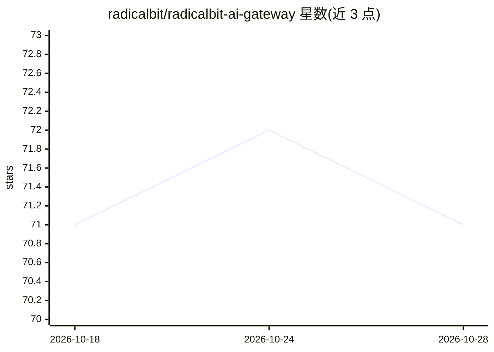

# radicalbit/radicalbit-ai-gateway

⭐ 71 · Python · Apache-2.0 · 推送 2026-10-28 · [GitHub](https://github.com/radicalbit/radicalbit-ai-gateway) · [官网](https://docs.ai-gateway.radicalbit.ai/) · 组织维护

**带护栏与可观测性的 LLM 网关，UI 配置并可自然语言生成 YAML**

面向开发与运维的 LLM 代理网关：提供多策略路由（关键词、token 数、时间、预算、语义、LLM 分类）、护栏（PII 检测/脱敏、LLM judge、模式匹配）、精确与语义缓存、速率/token/预算限制、跨提供商模型回退、MCP 代理与端到端请求追踪。原生支持 OpenAI、Anthropic、Gemini、DeepSeek、Mistral、Azure，兼容任意 OpenAI 格式端点（Ollama、vLLM 等）。通过 Docker Compose 部署，内置 UI 管理项目、路由与 API key，配置可用 AI 助手从自然语言生成 YAML，也可手写。另提供企业版治理层。

## 筛选速览

| 维度 | 判定 | 备注 |
|---|---|---|
| AI 角色 | `ai-ecosystem` | LLM/agent 周边工具 |
| 许可风险 | `permissive` | Apache-2.0 |
| 部署形态 | `self-host` | docker 或自建部署 |
| 模型依赖 | local-ok | 支持本地模型 |
| 硬件要求 | — | 无带数字的原话,不猜 |
| 安装摩擦 | `low` | 无编译、无系统依赖或容器化 |
| 成熟度 | — | 结构信号不足 |

## 能力要点

- 多策略路由：关键词/token/时间/预算/语义/LLM 分类
- 网关层护栏：Presidio PII 检测与脱敏、LLM-as-a-judge、模式匹配
- MCP 代理：聚合上游 MCP 服务器到单一路由端点
- 可观测性：Prometheus 指标、OpenTelemetry 追踪（ClickHouse 存储）、用量看板

## 适用场景

- 统一管理多个模型提供商的接入与密钥
- 在网关层拦截含 PII 或提示注入的请求
- 按预算与 token 用量自动降级到更便宜的模型
- 将多个上游 MCP 服务器聚合为一个受控端点

## 场景标签

`模型网关` `LLM 可观测性` · 领域:Agent 开发

## 证据(README 行号)

> L15: An LLM proxy with guardrails, rate limiting, multi-strategy routing, semantic caching, MCP proxy and end-to-end req
> L193: |**Providers**|Native|OpenAI, Anthropic, Google Gemini, DeepSeek, Mistral, Azure OpenAI|
> L194: ||Compatible|Any OpenAI-format endpoint: Ollama, vLLM, OpenRouter, on-premises|

## 星数曲线

2026-10-18 71 → 2026-10-28 71（+0）

---
*卡片 v1 · prompt 1.4 · 生成 2026-10-24 · 置信度 high · 依据 README sha `0ff169ca5875` · [字段定义](../../DATASET.md)*
