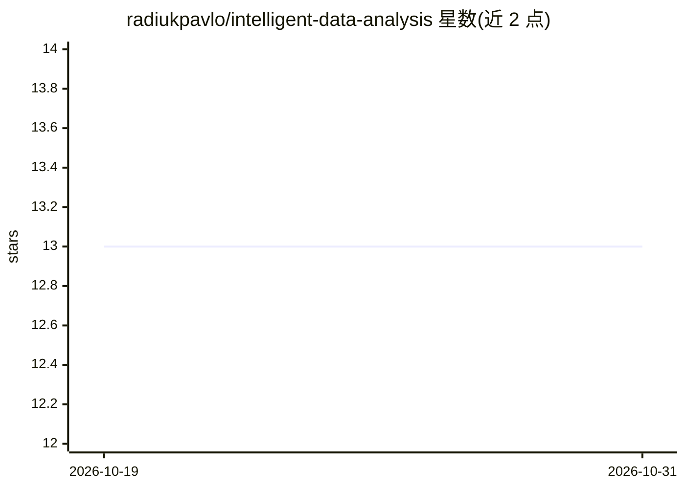

# radiukpavlo/intelligent-data-analysis

⭐ 13 · Jupyter Notebook · 推送 2026-10-09 · [GitHub](https://github.com/radiukpavlo/intelligent-data-analysis) · 组织维护

**计算机科学专业本科智能数据分析课程资料**

面向 F3 计算机科学专业本科生的必修课程 "智能数据分析"（乌克兰语授课）：基于高等数学、概率过程与数理统计的基础，讲授数据与集合的性质与运算、机器学习方法与原理、相关算法与软件工具，目标是使学生掌握数据处理与组合对象、系统及模型的工程基础。仓库以课程材料形式提供，主题标签含 jupyter-notebook、machine-learning、python，属于教学资源而非软件产品。

## 筛选速览

| 维度 | 判定 | 备注 |
|---|---|---|
| AI 角色 | `ai-knowledge` | 知识聚合/清单类 |
| 许可风险 | `none` | — |
| 部署形态 | `None` |  |
| 模型依赖 | — | README 未给出锁定关系 |
| 硬件要求 | — | 无带数字的原话,不猜 |
| 安装摩擦 | `low` | 无编译、无系统依赖或容器化 |
| 成熟度 | — | 结构信号不足 |

## 能力要点

- 课程覆盖数据运算、机器学习方法与算法原理
- 要求学生具备高等数学、概率与数理统计基础
- 仓库标签包含 jupyter-notebook、machine-learning、python

## 适用场景

- 计算机科学本科生学习数据分析与机器学习基础
- 教师参考课程结构与教学材料

## 场景标签

`教程课程` · 领域:学习与行业

## 证据(README 行号)

> L3: Курс "Інтелектуальний аналіз даних" призначений для підготовки бакалаврів з галузі знань F Інформаційні технології з
> L5: Метою викладання навчальної дисципліни є формування у студентів фундаментальних знань про принципи роботи з даними, 

## 星数曲线

2026-10-19 13 → 2026-10-31 13（+0）

---
*卡片 v1 · prompt 1.4 · 生成 2026-10-31 · 置信度 high · 依据 README sha `8f378498b37f` · [字段定义](../../DATASET.md)*
