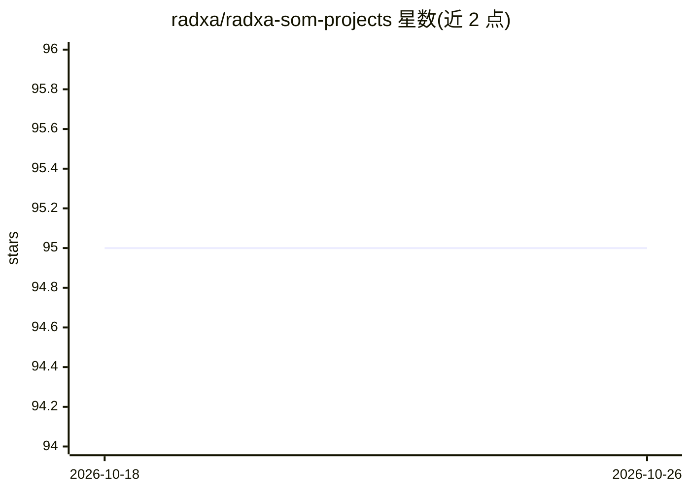

# radxa/radxa-som-projects

⭐ 95 · Python · 推送 2026-09-04 · [GitHub](https://github.com/radxa/radxa-som-projects) · [官网](https://docs.radxa.com/en/som) · 组织维护

**Radxa SoM 载板设计文件库+面向 LLM/Agent 的结构化硬件数据库**

Radxa 官方仓库，收录 CM/NX 系列计算机模组的载板设计文件（PDF、DSN、PCB、DXF、XLSX）及社区项目，覆盖 CM3/CM3I/CM4/CM5 与 NX5/NX4/Orin NX 等。另设 hardware-db 目录，将板卡引脚、接口、电源域等硬件约束以 JSON 表示，附 JSON Schema 与校验/生成脚本，供 Cursor、GitHub Copilot 等 LLM 与自主工程 agent 编程化查询，免去解析原理图 PDF。通过单一数据源管线保证人类文档与机器可读数据同步。

## 筛选速览

| 维度 | 判定 | 备注 |
|---|---|---|
| AI 角色 | `ai-knowledge` | 知识聚合/清单类 |
| 许可风险 | `none` | — |
| 部署形态 | `None` |  |
| 模型依赖 | — | README 未给出锁定关系 |
| 硬件要求 | — | 无带数字的原话,不猜 |
| 安装摩擦 | `low` | 无编译、无系统依赖或容器化 |
| 成熟度 | — | 结构信号不足 |

## 能力要点

- 载板设计文件（PDF/DSN/PCB/DXF/XLSX）公开下载
- hardware-db 以 JSON Schema 组织板卡引脚、接口、电源域数据
- validate_db.py / generate_readme_snippets.py 校验并生成文档摘要
- Pre-commit/CI 保证文档与结构化数据单一数据源同步

## 适用场景

- 查找 Radxa SoM 载板参考设计文件自行设计底板
- 让编程 agent 直接查询结构化硬件数据辅助底板开发
- 为硬件选型比对 CM/NX 系列模组规格

## 场景标签

 · 领域:嵌入式硬件/知识聚合

## 证据(README 行号)

> L3: Agentic Hardware Database
> L7: For Large Language Models (LLMs) and autonomous engineering agents (like Cursor, GitHub Copilot), this repository ac
> L31: Machine readable hardware knowledge is added under `hardware-db` for agents and automation.

## 星数曲线

2026-10-18 95 → 2026-10-26 95（+0）

---
*卡片 v1 · prompt 1.4 · 生成 2026-10-23 · 置信度 high · 依据 README sha `487af0ea74a1` · [字段定义](../../DATASET.md)*
