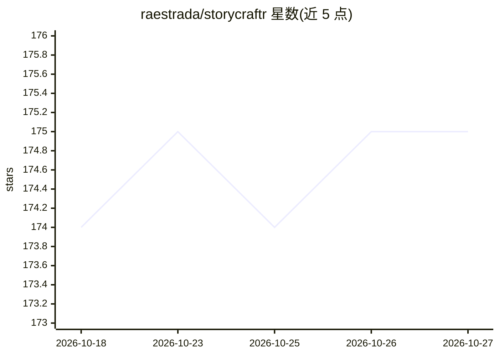

# raestrada/storycraftr

⭐ 175 · Python · MIT · 推送 2026-03-06 · [GitHub](https://github.com/raestrada/storycraftr) · 个人维护

**给小说作者的 CLI 工具：用 LLM 生成大纲、章节与世界观**

面向写作者的命令行写作助手：通过 storycraftr init 初始化书籍项目，支持世界设定构建、总体大纲生成、章节/封面/尾声自动生成，并提供交互式 Chat 会话（!iterate/!outline/!worldbuilding/!chapters 命令）与 VSCode 扩展。基于 LangChain，支持 OpenAI、OpenRouter、Ollama 三种 provider，凭据从环境变量或 ~/.storycraftr/ 下的文本文件自动发现；嵌入模型默认 BAAI/bge-large-en-v1.5。安装方式为 pipx 或 uvx，从 GitHub 指定 tag 安装，属 AI Craftr 套件（另有 PaperCraftr）。限制：示例安装命令绑定 beta 版本 v0.12.0-beta10。

## 筛选速览

| 维度 | 判定 | 备注 |
|---|---|---|
| AI 角色 | `ai-native` | 本体是模型或模型工具 |
| 许可风险 | `permissive` | MIT |
| 部署形态 | `None` |  |
| 模型依赖 | local-ok | 支持本地模型 |
| 硬件要求 | — | 无带数字的原话,不猜 |
| 安装摩擦 | `low` | 无编译、无系统依赖或容器化 |
| 成熟度 | — | 结构信号不足 |

## 能力要点

- CLI 生成世界设定、大纲、章节与封面文本
- 交互式 Chat 会话支持迭代修改与中途插入章节
- 基于 LangChain，支持 OpenAI/OpenRouter/Ollama 三种 provider
- 提供 VSCode 扩展（自动检测项目配置并引导安装）

## 适用场景

- 小说作者用自然语言生成和迭代故事大纲与章节
- 构建和管理世界观设定（历史、地理、魔法/技术体系）
- 在 VSCode 内直接进行 AI 辅助写作会话

## 场景标签

`AI 写作` · 领域:内容生成

## 证据(README 行号)

> L6: Welcome to **StoryCraftr**, the open-source project designed to revolutionize how books are written. With the power 
> L104: - **Outline**: Generate a cohesive story outline, from character summaries to chapter synopses.
> L105: - **Chapters**: Automatically generate chapters, cover pages, and epilogues based on your ideas.

## 星数曲线

2026-10-18 174 → 2026-10-27 175（+1）

---
*卡片 v1 · prompt 1.4 · 生成 2026-10-22 · 置信度 high · 依据 README sha `4f61b1f29cd0` · [字段定义](../../DATASET.md)*
