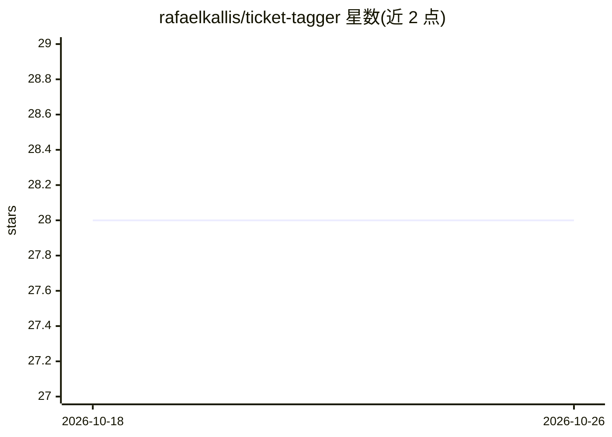

# rafaelkallis/ticket-tagger

⭐ 28 · TypeScript · AGPL-3.0 · 推送 2026-08-03 · [GitHub](https://github.com/rafaelkallis/ticket-tagger) · [官网](https://github.com/apps/ticket-tagger) · 个人维护

**基于机器学习的 GitHub issue 自动分类机器人**

以 GitHub App 形式提供的 issue 分类机器人：用户将其安装到仓库后，利用 Fasttext 机器学习模型对新建 issue 自动打标签。安装途径是访问 GitHub App 页面一键安装；开发模式下需 Node.js 编译与安装依赖，从源码 git clone 运行。项目基于 AGPL 许可，衍生自 BEE 与 Github Issue Classification Evaluation 两项工作。README 较简短，未给出模型细节与部署要求。

## 筛选速览

| 维度 | 判定 | 备注 |
|---|---|---|
| AI 角色 | `ai-native` | 本体是模型或模型工具 |
| 许可风险 | `viral` | AGPL-3.0 |
| 部署形态 | `None` |  |
| 模型依赖 | — | README 未给出锁定关系 |
| 硬件要求 | — | 无带数字的原话,不猜 |
| 安装摩擦 | `low` | 无编译、无系统依赖或容器化 |
| 成熟度 | — | 结构信号不足 |

## 能力要点

- 以 GitHub App 形式安装，无需本地部署即可使用
- 使用 Fasttext 模型对 issue 自动分类
- 开发模式提供 git clone 源码运行方式，需 Node.js

## 适用场景

- 我想让新提的 issue 自动打上分类标签，减少人工整理
- 维护多个开源仓库时自动归类 issue

## 场景标签

 · 领域:开发工具/机器学习

## 证据(README 行号)

> L3: Machine learning driven issue classification bot.
> L27: - Fasttext

## 星数曲线

2026-10-18 28 → 2026-10-26 28（+0）

---
*卡片 v1 · prompt 1.4 · 生成 2026-10-26 · 置信度 high · 依据 README sha `0badcd3155d5` · [字段定义](../../DATASET.md)*
