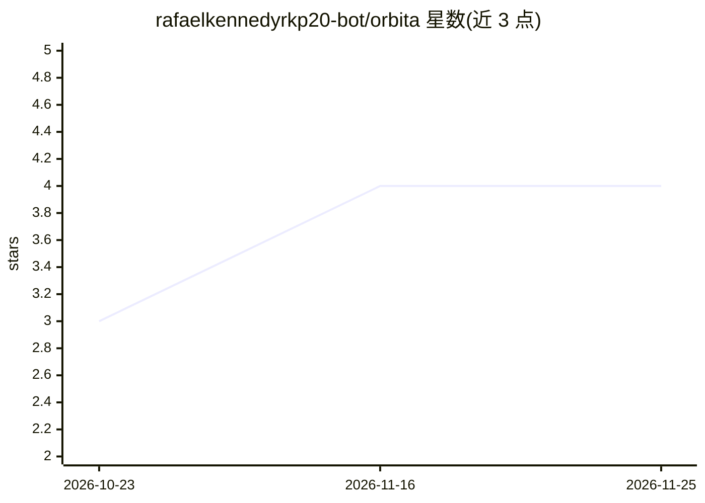

# rafaelkennedyrkp20-bot/orbita

⭐ 4 · Python · GPL-3.0 · 推送 2026-11-17 · [GitHub](https://github.com/rafaelkennedyrkp20-bot/orbita) · 个人维护

**Windows/Linux 个人 AI 代理：对话、编程、操作电脑并协调代理团队**

以源码分发的桌面个人 AI 代理，通过 .bat/.sh 启动脚本自动创建 venv 并安装依赖。核心机制：模型可自选（Ollama 本地或云 API）、MCP 协议连接外部软件、多代理团队分工（编程/审查/研究/设计/逆向）并由主代理委派与复核、上下文满时自动摘要压缩、按任务/日设置 token 预算。工具覆盖文件读写、PowerShell/bash、截屏视觉、鼠标键盘、图像生成与语音转录。仓库仅含代码，模型、密钥与记忆留在本机。

## 筛选速览

| 维度 | 判定 | 备注 |
|---|---|---|
| AI 角色 | `ai-native` | 本体是模型或模型工具 |
| 许可风险 | `viral` | GPL-3.0 |
| 部署形态 | `desktop` | 安装包/桌面程序 |
| 模型依赖 | local-ok | 支持本地模型 |
| 硬件要求 | — | 无带数字的原话,不猜 |
| 安装摩擦 | `medium` | 含编译或系统依赖之一 |
| 成熟度 | `idea` | |

## 能力要点

- MCP 标准连接外部程序，兼容 Claude Desktop/Cursor 格式的 mcp.json 并可一键导入
- 多代理团队（编程、审查、研究、设计、逆向工程），各成员可用不同模型/API 并按质量×成本自动路由
- 无工具调用支持的模型可通过"提示注入工具"模式使用
- 语音输入：有 Groq/OpenAI key 走云端转录，无 key 用本机轻量模型

## 适用场景

- 在本机用本地模型搭建不依赖云端的个人助手
- 让代理团队协作完成代码项目并自动审查
- 通过 MCP 让 AI 操作已安装的软件与文件
- 控制日常任务的 token 开销与执行权限级别

## 场景标签

`AI 助手` `多智能体` · 领域:Agent 开发

## 证据(README 行号)

> L6:  Conversa, programa, pesquisa, mexe em arquivos e programas e coordena uma equipe de agentes.
> L83: |**Qualquer IA**|Ollama, DeepSeek, OpenAI, Claude, **Grok Build (conta xAI)**, Gemini, OpenRouter, Groq, xAI, Mistr
> L88: |**Equipe de agentes**|Programador, Revisor, Pesquisador, Designer e Engenharia Reversa. Cada um pode usar **outro 

## 星数曲线

2026-10-23 3 → 2026-11-25 4（+1）

---
*卡片 v1 · prompt 1.4 · 生成 2026-11-21 · 置信度 mid · 依据 README sha `01b29a89740d` · [字段定义](../../DATASET.md)*
