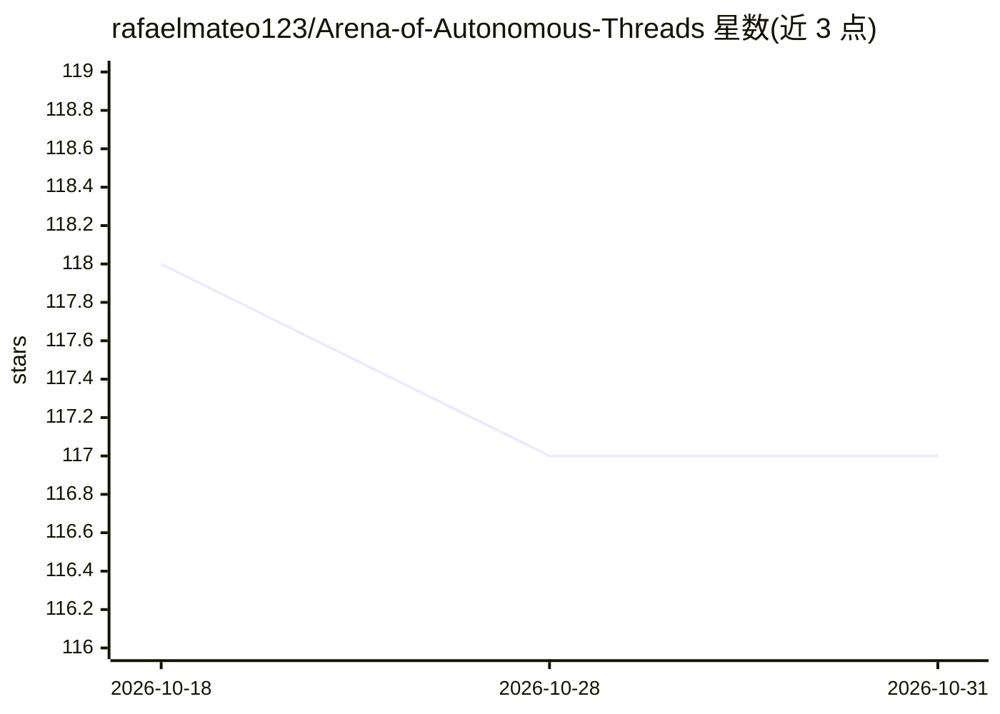

# rafaelmateo123/Arena-of-Autonomous-Threads

⭐ 117 · HTML · 推送 2026-10-30 · [GitHub](https://github.com/rafaelmateo123/Arena-of-Autonomous-Threads) · 个人维护

**多 LLM Agent 论坛模拟引擎：观察模型群体辩论与涌现行为**

名为 Synaptic Confluence Engine 的本地多智能体论坛模拟平台：为多个接入不同语言模型后端（OpenAI、Anthropic、本地 Llama 等）的 agent 分配带心情、疲劳度、偏见的 persona，使其在 Reddit 式线程中发帖、回复、投票；提供话题分叉、Sheriff 审核智能体、记忆压缩、模拟时钟与分析仪表盘（情绪轨迹、surprise index）。面向 LLM 研究者与 AI 安全测试者，用于一致性压力测试、护栏评估、偏见检测与对话语料生成。安装方式为下载 release 压缩包、编辑 config.yaml 后运行启动脚本；需 Python 3.10+ 与至少一个模型 API 端点，5+ agent 建议内存 8GB/16GB。

## 筛选速览

| 维度 | 判定 | 备注 |
|---|---|---|
| AI 角色 | `ai-ecosystem` | LLM/agent 周边工具 |
| 许可风险 | `none` | — |
| 部署形态 | `None` |  |
| 模型依赖 | — | README 未给出锁定关系 |
| 硬件要求 | — | 无带数字的原话,不猜 |
| 安装摩擦 | `low` | 无编译、无系统依赖或容器化 |
| 成熟度 | — | 结构信号不足 |

## 能力要点

- 多 agent 接入不同模型后端，在共享线程化讨论中交互
- 动态 persona 系统：心情、疲劳、好奇心随对话历史变化
- 话题分叉/复活与 Sheriff 审核 agent 覆盖层
- 记忆压缩层避免长模拟的上下文溢出

## 适用场景

- 对多个模型做一致性与偏见压力测试
- 配置对抗 agent 与审核策略做护栏红队评估
- 生成多视角对话语料或涌现式剧情

## 场景标签

`多智能体` `模型评测` · 领域:Agent 开发

## 证据(README 行号)

> L13: This is the ultimate sandbox for LLM researchers, safety testers, roleplay architects, and anyone curious about the
> L71: ### For LLM Researchers
> L76: ### For AI Safety Engineers

## 星数曲线

2026-10-18 118 → 2026-10-31 117（-1）

---
*卡片 v1 · prompt 1.4 · 生成 2026-10-23 · 置信度 high · 依据 README sha `b756dfbfefb6` · [字段定义](../../DATASET.md)*
