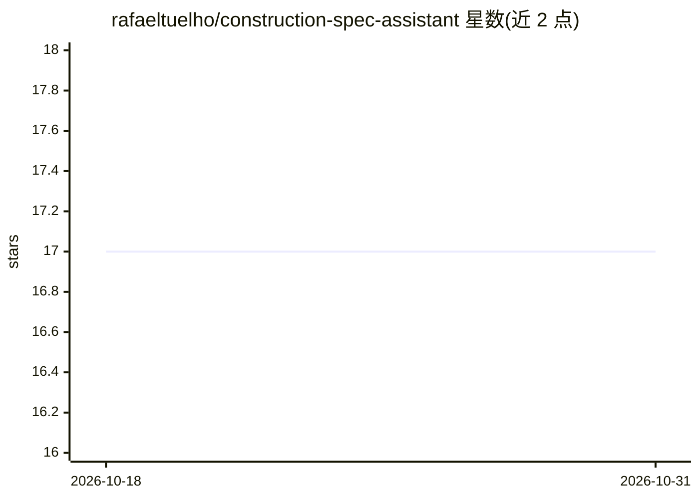

# rafaeltuelho/construction-spec-assistant

⭐ 17 · Jupyter Notebook · 推送 2025-11-11 · [GitHub](https://github.com/rafaeltuelho/construction-spec-assistant) · 个人维护

**帮建筑架构师审查施工文档与承包商送审件不一致的智能体系统**

面向建筑架构师的智能体 AI 系统：读取 CSI 标准格式的施工规范、承包商送审件与产品说明书 PDF，通过 Docling OCR 解析后，用 LLM 以 EAV JSONL 模式抽取技术事实，经分块与向量索引（FastEmbed + Qdrant 混合检索），由 LangGraph 比较智能体将规范事实与送审件相关章节比对，生成附原文证据的不一致报告。含 FastAPI 后端与 React Web 界面原型；CAD 图纸解析尚未实现。文档整体为一认证课程的挑战作业记录，本地模型（Ollama）支持列为计划项。

## 筛选速览

| 维度 | 判定 | 备注 |
|---|---|---|
| AI 角色 | `ai-native` | 本体是模型或模型工具 |
| 许可风险 | `none` | — |
| 部署形态 | `None` |  |
| 模型依赖 | — | README 未给出锁定关系 |
| 硬件要求 | — | 无带数字的原话,不猜 |
| 安装摩擦 | `low` | 无编译、无系统依赖或容器化 |
| 成熟度 | — | 结构信号不足 |

## 能力要点

- LLM 按 EAV JSONL 模式从 CSI 规范抽取技术事实并附证据
- LangGraph 比较智能体以 RAG 方式比对规范事实与送审件章节
- Ensemble Retriever（Parent Document + BM25）混合检索，用 RAGAS 指标评测选型
- FastAPI 后端 + React Web UI，Swagger/ReDoc API 文档

## 适用场景

- 审查施工规范与承包商送审件之间的技术不一致
- 替代手工对照多份长篇 PDF 的文档审查流程
- 生成带原文证据的比对报告供架构师复核

## 场景标签

`RAG` `文档问答` · 领域:知识与检索

## 证据(README 行号)

> L4: This is an **agentic AI system** designed to help Construction Architects review construction documents and identify
> L67:  * **Fact Extraction**: We use an LLM to extract technical facts from the CSI Specifications using a flexible **EAV
> L68:  * **Comparison**: We use a LangChain agent to orchestrate the comparison workflow. The agent uses a Retrieval-Augm

## 星数曲线

2026-10-18 17 → 2026-10-31 17（+0）

---
*卡片 v1 · prompt 1.4 · 生成 2026-10-29 · 置信度 high · 依据 README sha `5b46d21d5a1e` · [字段定义](../../DATASET.md)*
