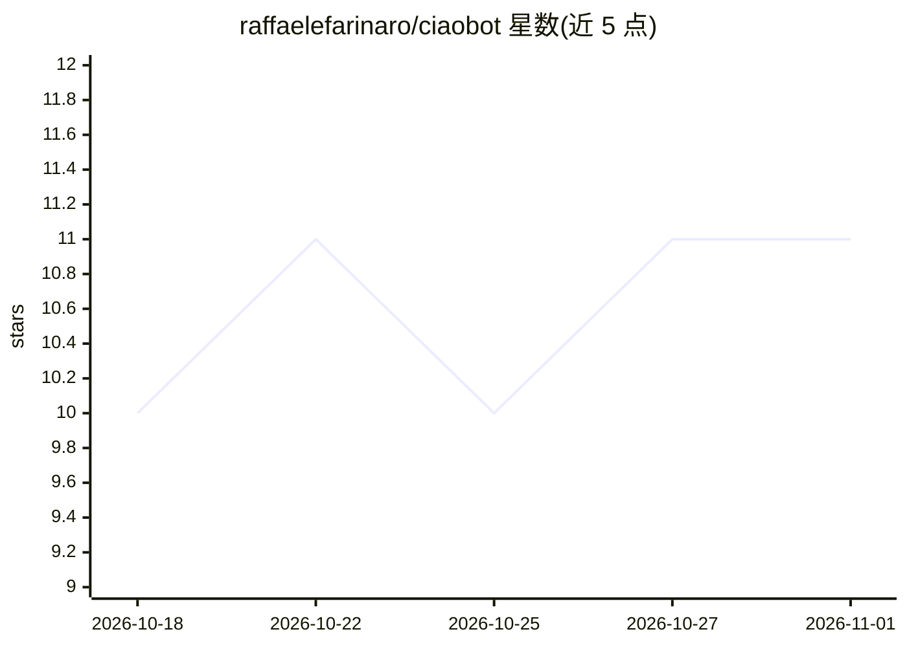

# raffaelefarinaro/ciaobot

⭐ 11 · Python · Apache-2.0 · 推送 2026-10-31 · [GitHub](https://github.com/raffaelefarinaro/ciaobot) · [官网](https://www.raffaelefarinaro.com/ciaobot/) · 个人维护

**围绕 Claude Code/OpenCode 的个人助理与第二大脑工作区**

面向个人用户的持久工作区应用：调用已登录的 Claude Code 或 OpenCode CLI 执行任务，在其上添加项目、持久记忆、文件与定时任务，按 workspace→project→chat 组织。聊天归档时将有价值内容以 Markdown 存入用户自选文件夹；记忆支持提案、撤销与夜间整理。云端或本地模型均可，通过 OpenCode 可接入 OpenAI、OpenRouter、Ollama 等提供商。macOS（Apple Silicon）提供安装脚本，Windows 11 为预览版。

## 筛选速览

| 维度 | 判定 | 备注 |
|---|---|---|
| AI 角色 | `ai-native` | 本体是模型或模型工具 |
| 许可风险 | `permissive` | Apache-2.0 |
| 部署形态 | `library` | 以包/库形式分发 |
| 模型依赖 | local-ok | 支持本地模型 |
| 硬件要求 | — | 无带数字的原话,不猜 |
| 安装摩擦 | `low` | 无编译、无系统依赖或容器化 |
| 成熟度 | `idea` | |

## 能力要点

- 驱动 Claude Code/OpenCode CLI，自身无模型账号
- 归档聊天生成 Markdown 笔记，文件夹归用户所有
- 可审查的记忆系统：提案、撤销、夜间整理
- 项目可关联 git 仓库并提供代码模式

## 适用场景

- 让多个 AI 代理共享同一份项目背景与持久记忆
- 把每周重复任务设为定时自动化并查看结果
- 在聊天旁管理、批注自己的 Markdown 笔记

## 场景标签

`编码 Agent` `AI 助手` `知识库管理` · 领域:编码与开发

## 证据(README 行号)

> L5: Ciaobot is your **second brain and personal assistant**: a persistent personal workspace for the agents you already 
> L7: **Your agents do the work. Ciaobot keeps the context.** Claude Code and OpenCode handle models and tools; Ciaobot ad
> L41: - **Claude:** install Claude Code (`curl -fsSL https://claude.ai/install.sh | bash`) and run `claude auth login`. I

## 星数曲线

2026-10-18 10 → 2026-11-01 11（+1）

---
*卡片 v1 · prompt 1.4 · 生成 2026-11-01 · 置信度 mid · 依据 README sha `13facdbe3153` · [字段定义](../../DATASET.md)*
