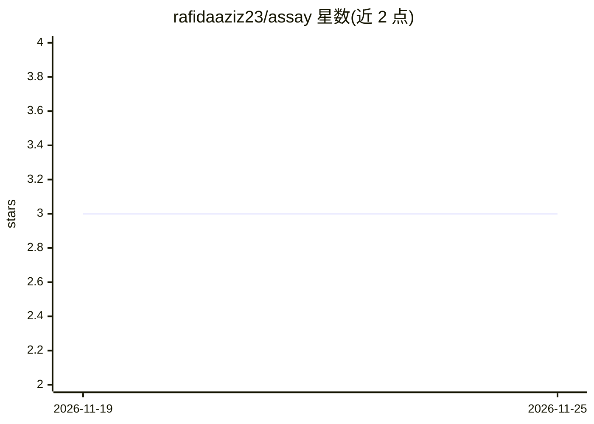

# rafidaaziz23/assay

⭐ 3 · Python · MIT · 推送 2026-10-18 · [GitHub](https://github.com/rafidaaziz23/assay) · [官网](https://assay-web-204598097710.asia-southeast1.run.app/) · 个人维护

**面向学习者的苏格拉底式考核工具：AI 只提问不解释**

Assay 是一个学习工具：用户输入主题或 PDF，生成带门禁的教学大纲，每个章节需通过苏格拉底式口头答辩（分数≥75）才解锁下一章。AI 引擎拒绝直接给出答案（`gave_direct_answer: false`），并在材料中植入虚构概念（honeypot）以检测用户粘贴 LLM 回答的行为；专注度追踪通过浏览器端的 MediaPipe 视线/人脸信号实现，视频帧不上传。技术栈为 FastAPI 后端 + React 前端，部署于 Google Cloud Run，依赖 Gemini 模型，提供 Docker 一键启动与 cached 演示模式。

## 筛选速览

| 维度 | 判定 | 备注 |
|---|---|---|
| AI 角色 | `ai-native` | 本体是模型或模型工具 |
| 许可风险 | `permissive` | MIT |
| 部署形态 | `self-host` | docker 或自建部署 |
| 模型依赖 | — | README 未给出锁定关系 |
| 硬件要求 | — | 无带数字的原话,不猜 |
| 安装摩擦 | `low` | 无编译、无系统依赖或容器化 |
| 成熟度 | `idea` | |

## 能力要点

- 门禁式教学大纲与口头答辩解锁机制
- honeypot 虚构概念检测粘贴式回答
- 浏览器端专注度追踪，视频不出浏览器
- 校准报告：先自评分数再对比差距

## 适用场景

- 为需要深度掌握的学科生成自测式学习路径
- 检验自己是否真的理解而非读过解释
- 在没有外部监考的远程学习中约束自己

## 场景标签

`AI 助手` · 领域:对话与助手

## 证据(README 行号)

> L29: Assay is a study tool that refuses to hand you answers.
> L31: You give it a topic or a PDF, and it builds a gated syllabus — then makes you

## 星数曲线

2026-11-19 3 → 2026-11-25 3（+0）

---
*卡片 v1 · prompt 1.4 · 生成 2026-11-21 · 置信度 high · 依据 README sha `7df7463f5f9b` · [字段定义](../../DATASET.md)*
