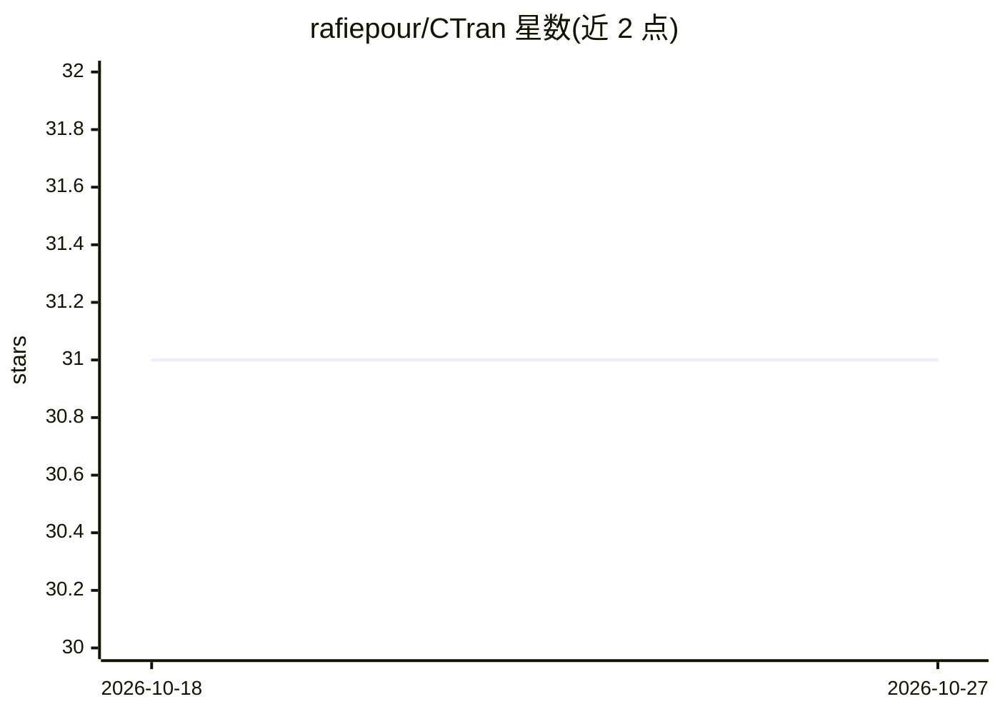

# rafiepour/CTran

⭐ 31 · Jupyter Notebook · Apache-2.0 · 推送 2026-06-21 · [GitHub](https://github.com/rafiepour/CTran) · [官网](https://github.com/rafiepour/CTran) · 个人维护

**面向 NLU 的 CNN-Transformer 联合意图识别与槽填充模型实现**

论文《CTRAN: CNN-Transformer-based network for natural language understanding》的 PyTorch 官方实现，代码覆盖自然语言理解两大任务：意图检测与槽填充。机制上采用共享编码器（BERT 词嵌入 + 卷积 + 'window feature sequence' 结构 + Transformer 编码器堆叠），意图检测由自注意力加线性层输出，槽填充由提出的 Aligned Transformer 解码器完成。默认使用 bert-base-uncased，实验中推荐 bert-large-uncased。需 CUDA GPU、Python、PyTorch 与 Jupyter，提供 ATIS 与 SNIPS 数据集上的训练时间参考。

## 筛选速览

| 维度 | 判定 | 备注 |
|---|---|---|
| AI 角色 | `ai-native` | 本体是模型或模型工具 |
| 许可风险 | `permissive` | Apache-2.0 |
| 部署形态 | `None` |  |
| 模型依赖 | — | README 未给出锁定关系 |
| 硬件要求 | — | 无带数字的原话,不猜 |
| 安装摩擦 | `medium` | 含编译或系统依赖之一 |
| 成熟度 | — | 结构信号不足 |

## 能力要点

- CNN 与 Transformer 结合的共享编码器，联合意图检测与槽填充
- 提出 Aligned Transformer 解码器用于槽填充任务
- BERT 词嵌入（默认 bert-base-uncased，实验用 bert-large-uncased）
- ATIS 与 SNIPS 数据集上的训练时间参考数据

## 适用场景

- 复现论文中的 CTRAN 模型实验结果
- 在 ATIS/SNIPS 上做联合意图识别与槽填充研究
- 作为 CNN-Transformer 编码器-解码器架构的参考实现

## 场景标签

`模型训练` · 领域:训练与推理

## 证据(README 行号)

> L8: This repository contains the complete source code of the proposed CTRAN network for joint intent detection and slot 
> L2: The pytorch implementation as described in <https://www.sciencedirect.com/science/article/pii/S0952197623011971>.

## 星数曲线

2026-10-18 31 → 2026-10-27 31（+0）

---
*卡片 v1 · prompt 1.4 · 生成 2026-10-26 · 置信度 high · 依据 README sha `0eca097a55ae` · [字段定义](../../DATASET.md)*
