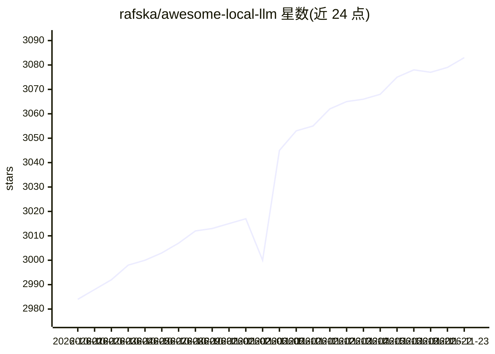

# rafska/awesome-local-llm

⭐ 3,083 · MIT · 推送 2026-11-16 · [GitHub](https://github.com/rafska/awesome-local-llm) · 个人维护

**本地运行 LLM 的平台/引擎/模型资源策展清单**

按目录结构组织的 awesome 清单，收录帮助在本地运行 LLM 的平台、推理引擎、用户界面、模型与基准资源。条目分为推理平台、推理引擎、用户界面、语言模型（含基准/排行榜、模型提供方、通用/编程/决策/多模态/图像/音频等子类）等章节，每条附一行简介与链接。覆盖 ollama、llama.cpp、vllm 等本地运行时，以及多家机构的开源权重模型。

## 筛选速览

| 维度 | 判定 | 备注 |
|---|---|---|
| AI 角色 | `ai-knowledge` | 知识聚合/清单类 |
| 许可风险 | `permissive` | MIT |
| 部署形态 | `None` |  |
| 模型依赖 | — | README 未给出锁定关系 |
| 硬件要求 | — | 无带数字的原话,不猜 |
| 安装摩擦 | `medium` | 含编译或系统依赖之一 |
| 成熟度 | — | 结构信号不足 |

## 能力要点

- 按推理平台/引擎/界面/模型分类组织的目录结构
- 收录本地推理引擎约 30 个（含 Apple Silicon、AMD、NPU 等硬件方向条目）
- 模型条目按通用、编程、决策、多模态、图像、音频细分
- 附基准、排行榜与模型选型资源

## 适用场景

- 为本地部署 LLM 挑选推理引擎或桌面客户端
- 按用途（编程/语音/图像）查找开源权重模型
- 了解本地 LLM 生态的基准与对比资源

## 场景标签

`精选清单` · 领域:学习与行业

## 证据(README 行号)

> L1: # Awesome local LLM
> L2: A curated list of awesome platforms, tools, practices and resources that helps run LLMs locally

## 星数曲线

2026-10-21 2,984 → 2026-11-23 3,083（+99）

---
*卡片 v1 · prompt 1.4 · 生成 2026-11-23 · 置信度 high · 依据 README sha `ac7d3409545b` · [字段定义](../../DATASET.md)*
