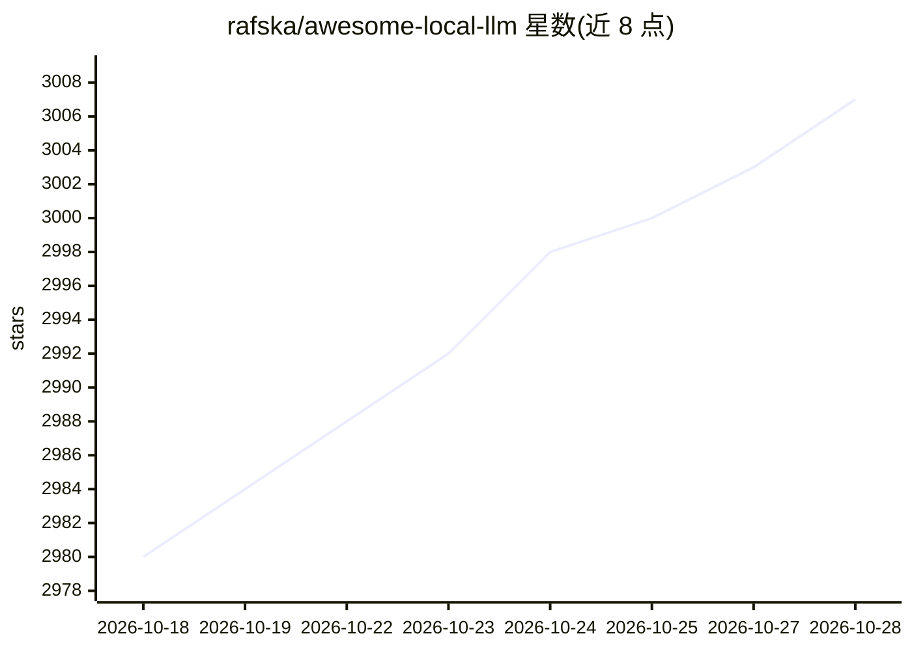

# rafska/awesome-local-llm

⭐ 3,007 · MIT · 推送 2026-10-21 · [GitHub](https://github.com/rafska/awesome-local-llm) · 个人维护

**本地运行 LLM 的平台、工具与资源策展清单**

策展型 awesome 清单，聚合在本地运行大语言模型所需的各类资源：推理平台（LM Studio、LocalAI、jan 等）、推理引擎（ollama、llama.cpp、vLLM、exo 等）、用户界面（Open WebUI、Lobe Chat 等）、模型基准与排行榜、模型提供方、以及通用/编码/多模态/图像/音频/RAG 等类别的具体模型条目。面向希望在本地部署或自托管 LLM 的开发者与用户，条目以链接加一句描述的形式组织，不提供安装或运行代码。

## 筛选速览

| 维度 | 判定 | 备注 |
|---|---|---|
| AI 角色 | `ai-knowledge` | 知识聚合/清单类 |
| 许可风险 | `permissive` | MIT |
| 部署形态 | `None` |  |
| 模型依赖 | — | README 未给出锁定关系 |
| 硬件要求 | — | 无带数字的原话,不猜 |
| 安装摩擦 | `medium` | 含编译或系统依赖之一 |
| 成熟度 | — | 结构信号不足 |

## 能力要点

- 覆盖推理平台、推理引擎、用户界面三类本地运行工具
- 收录模型基准、排行榜与模型提供方信息
- 按通用、编码、多模态、图像、音频、RAG 等类别组织具体模型条目

## 适用场景

- 挑选适合本地运行 LLM 的推理平台或引擎
- 查找本地可用的开源模型（编码、多模态、语音等）
- 了解本地 LLM 生态的工具与资源分布

## 场景标签

`精选清单` · 领域:学习与行业

## 证据(README 行号)

> L2: A curated list of awesome platforms, tools, practices and resources that helps run LLMs locally
> L4: ## Table of Contents

## 星数曲线

2026-10-18 2,980 → 2026-10-28 3,007（+27）

---
*卡片 v1 · prompt 1.4 · 生成 2026-10-20 · 置信度 high · 依据 README sha `c803863cf8bb` · [字段定义](../../DATASET.md)*
