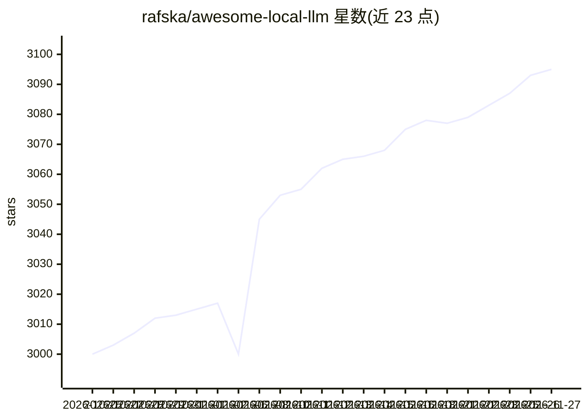

# rafska/awesome-local-llm

⭐ 3,095 · MIT · 推送 2026-11-24 · [GitHub](https://github.com/rafska/awesome-local-llm) · 个人维护

**本地运行 LLM 的平台、工具与模型资源清单**

以 awesome-list 形式组织的本地 LLM 生态资源目录，按推理平台、推理引擎、用户界面、大语言模型（含基准榜单、模型提供方、通用/编程/决策/多模态/图像/音频模型）等章节分类，逐条附一句描述并链接仓库或官网。定位为帮助用户在本地设备上运行 LLM 的资源导航，不含自身可安装的代码，也无使用说明；收录范围覆盖 NVIDIA/AMD/Apple Silicon 等不同硬件路径的推理引擎与开源模型集合。

## 筛选速览

| 维度 | 判定 | 备注 |
|---|---|---|
| AI 角色 | `ai-knowledge` | 知识聚合/清单类 |
| 许可风险 | `permissive` | MIT |
| 部署形态 | `None` |  |
| 模型依赖 | — | README 未给出锁定关系 |
| 硬件要求 | — | 无带数字的原话,不猜 |
| 安装摩擦 | `medium` | 含编译或系统依赖之一 |
| 成熟度 | — | 结构信号不足 |

## 能力要点

- 分类覆盖推理平台、推理引擎、UI、模型与基准榜单
- 收录 ollama、llama.cpp、vllm 等本地推理引擎条目
- 按用途细分模型章节：通用、编程、决策、多模态、图像、音频

## 适用场景

- 挑选适合自己设备的本地 LLM 推理引擎或平台
- 按任务（编程/图像/语音）查找开源模型资源
- 了解本地 LLM 生态中有哪些工具与基准榜单

## 场景标签

`精选清单` · 领域:学习与行业

## 证据(README 行号)

> L1: # Awesome local LLM
> L2: A curated list of awesome platforms, tools, practices and resources that helps run LLMs locally
> L6: ## Inference platforms

## 星数曲线

2026-10-25 3,000 → 2026-11-27 3,095（+95）

---
*卡片 v1 · prompt 1.4 · 生成 2026-11-26 · 置信度 high · 依据 README sha `350fe141c6b2` · [字段定义](../../DATASET.md)*
