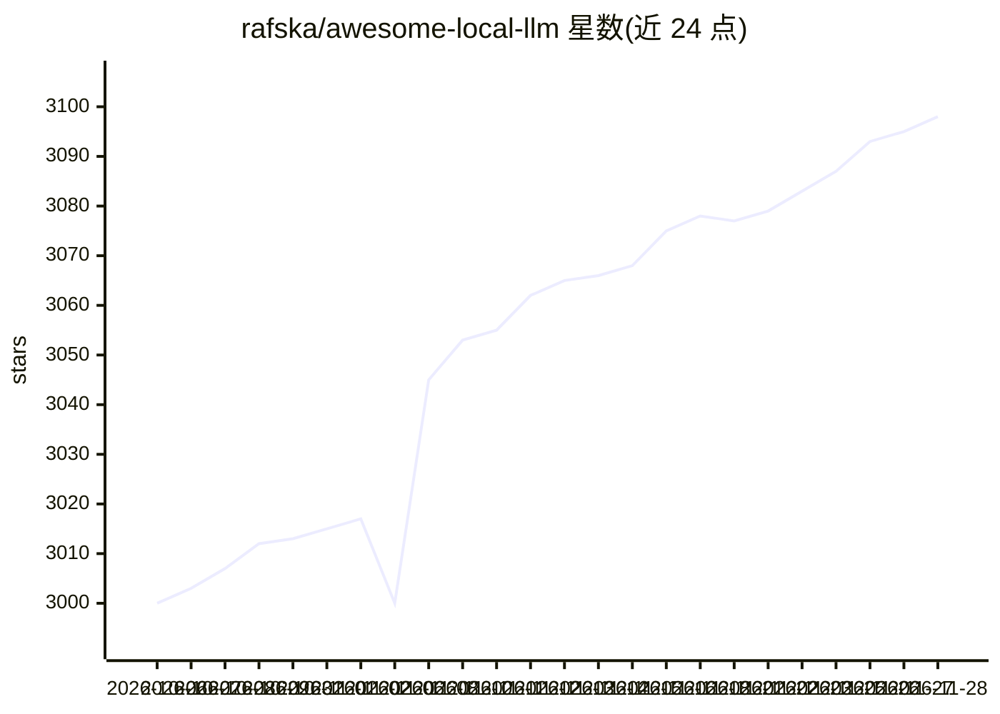

# rafska/awesome-local-llm

⭐ 3,098 · MIT · 推送 2026-11-27 · [GitHub](https://github.com/rafska/awesome-local-llm) · 个人维护

**本地运行 LLM 的平台、工具与资源清单**

一个 awesome 类策展清单，收录帮助在本地运行大语言模型的平台、推理引擎、用户界面、模型资源与基准测试条目。按类别组织：推理平台、推理引擎（ollama、llama.cpp、vllm 等）、前端界面、通用/代码/多模态/图像/音频等具体模型，以及基准与模型提供方。条目均为带一句话简介的外链，README 本身不包含代码、安装命令或运行说明，仅面向寻找本地 LLM 生态资源的读者。

## 筛选速览

| 维度 | 判定 | 备注 |
|---|---|---|
| AI 角色 | `ai-knowledge` | 知识聚合/清单类 |
| 许可风险 | `permissive` | MIT |
| 部署形态 | `None` |  |
| 模型依赖 | — | README 未给出锁定关系 |
| 硬件要求 | — | 无带数字的原话,不猜 |
| 安装摩擦 | `medium` | 含编译或系统依赖之一 |
| 成熟度 | — | 结构信号不足 |

## 能力要点

- 收录推理平台、推理引擎、UI 前端、模型与基准等多类条目
- 按用途分类：通用、Coding、Decision、Multimodal、Image、Audio
- 覆盖 Apple Silicon、AMD、Intel、NPU 等本地运行相关条目
- 纯策展清单，条目为一句话简介加外链

## 适用场景

- 挑选适合自己硬件的本地 LLM 推理引擎
- 查找可离线运行的开源模型与语音/图像模型
- 了解本地 LLM 生态有哪些平台和前端界面

## 场景标签

`精选清单` · 领域:学习与行业

## 证据(README 行号)

> L1: # Awesome local LLM
> L2: A curated list of awesome platforms, tools, practices and resources that helps run LLMs locally

## 星数曲线

2026-10-26 3,000 → 2026-11-28 3,098（+98）

---
*卡片 v1 · prompt 1.4 · 生成 2026-11-28 · 置信度 high · 依据 README sha `f29dbff45cae` · [字段定义](../../DATASET.md)*
