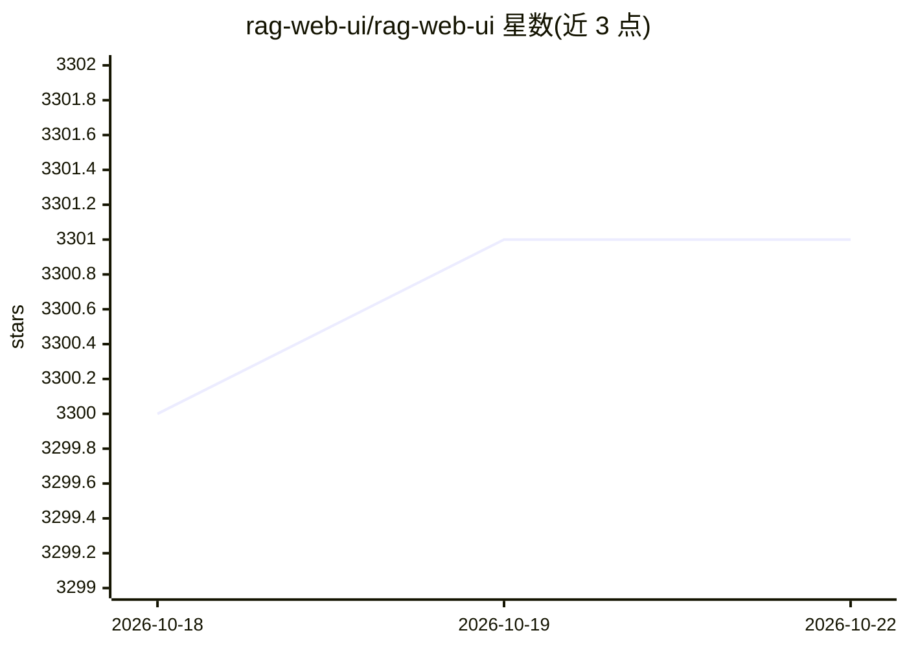

# rag-web-ui/rag-web-ui

⭐ 3,301 · TypeScript · Apache-2.0 · 推送 2026-04-06 · [GitHub](https://github.com/rag-web-ui/rag-web-ui) · 组织维护 · 中文 README

**基于 RAG 的私有知识库问答 Web 系统**

前后端分离的智能对话系统：上传 PDF/DOCX/Markdown/文本文档后自动分块与向量化，结合检索与大语言模型生成带引用的知识库问答，支持多轮上下文对话，并提供 OpenAPI 接口供外部调用。LLM 可接 OpenAI、DeepSeek、MiniMax 云服务或通过 Ollama 本地部署；向量库支持 ChromaDB 与 Qdrant 切换，存储用 MySQL+MinIO。以 Docker Compose 一键部署，README 声明仅供学习分享、未达到生产可用且仍在开发中。

## 筛选速览

| 维度 | 判定 | 备注 |
|---|---|---|
| AI 角色 | `ai-native` | 本体是模型或模型工具 |
| 许可风险 | `permissive` | Apache-2.0 |
| 部署形态 | `self-host` | docker 或自建部署 |
| 模型依赖 | local-ok | 支持本地模型 |
| 硬件要求 | — | 无带数字的原话,不猜 |
| 安装摩擦 | `low` | 无编译、无系统依赖或容器化 |
| 成熟度 | `idea` | |

## 能力要点

- 多格式文档管理与自动分块向量化、增量更新
- RAG 问答带引用与多轮上下文对话
- LLM 支持 OpenAI/DeepSeek/MiniMax 云服务与 Ollama 本地部署
- 向量库支持 ChromaDB/Qdrant，Factory 模式切换

## 适用场景

- 把企业或个人文档建成知识库做问答
- 私有化部署 LLM 满足隐私与成本要求
- 通过 OpenAPI 将知识库能力接入其他系统

## 场景标签

`文档问答` `RAG` · 领域:知识与检索

## 证据(README 行号)

> L20: RAG Web UI is an intelligent dialogue system based on RAG (Retrieval-Augmented Generation) technology that helps bu
> L22: The system supports multiple **LLM** deployment options, including cloud services like **OpenAI**, **DeepSeek**, an
> L33:  - Precise retrieval and generation based on RAG

## 星数曲线

2026-10-18 3,300 → 2026-10-22 3,301（+1）

---
*卡片 v1 · prompt 1.4 · 生成 2026-10-20 · 置信度 high · 依据 README sha `5e330fe1ff8d` · [字段定义](../../DATASET.md)*
