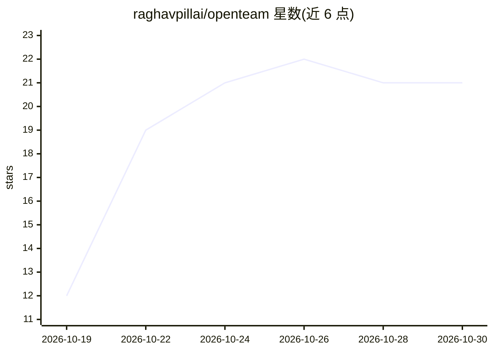

# raghavpillai/openteam

⭐ 21 · TypeScript · GPL-3.0 · 推送 2026-10-29 · [GitHub](https://github.com/raghavpillai/openteam) · [官网](https://openteam.so) · 组织维护

**自托管多 AI 代理：带持久记忆、浏览器与电脑访问及定时任务**

自托管 AI 代理平台：每个 bot 拥有独立屏幕与浏览器，共享工作区与网站登录态，对话与记忆在重启后保留。支持多 bot 群聊互发消息、向子代理委派任务，可将指令保存为例行任务按计划或事件触发执行。通过技能与插件接入 Gmail、GitHub、Slack、Notion，或连接自定义 MCP 服务器。模型可经 ChatGPT/Claude 登录或 OpenAI、Anthropic、OpenRouter API key 接入，也可用 openteam provider add 接自有模型服务器。服务端在 Docker 中运行，需宿主机与 Docker 持续在线；提供 macOS、Linux 桌面应用与 iPhone（beta）应用，经 curl 或 PowerShell 脚本安装。GPL-3.0 许可。

## 筛选速览

| 维度 | 判定 | 备注 |
|---|---|---|
| AI 角色 | `ai-native` | 本体是模型或模型工具 |
| 许可风险 | `viral` | GPL-3.0 |
| 部署形态 | `self-host` | docker 或自建部署 |
| 模型依赖 | — | README 未给出锁定关系 |
| 硬件要求 | — | 无带数字的原话,不猜 |
| 安装摩擦 | `low` | 无编译、无系统依赖或容器化 |
| 成熟度 | — | 结构信号不足 |

## 能力要点

- 每个 bot 独立屏幕/浏览器，共享工作区与网站登录
- 对话与跨会话记忆在重启后保留
- 例行任务按计划或事件触发自动执行
- 支持自定义 MCP 服务器与插件接入外部服务

## 适用场景

- 在自己硬件上运行可浏览网页、操作电脑的 AI 代理
- 把重复性工作配置为定时自动执行的例行任务
- 多代理协作：群聊沟通并委派子代理任务

## 场景标签

`多智能体` `浏览器自动化` `GUI 自动化` `AI 助手` · 领域:Agent 开发

## 证据(README 行号)

> L3: **Self-hosted AI agents that keep working on your own hardware.**
> L16: - **Give bots a computer.** Each bot has its own screen and browser. All bots share a workspace
> L20: - **Work as a team.** Bring multiple bots into a group chat, let them message each other, or delegate

## 星数曲线

2026-10-19 12 → 2026-10-30 21（+9）

---
*卡片 v1 · prompt 1.4 · 生成 2026-10-27 · 置信度 high · 依据 README sha `edd6d4c81428` · [字段定义](../../DATASET.md)*
