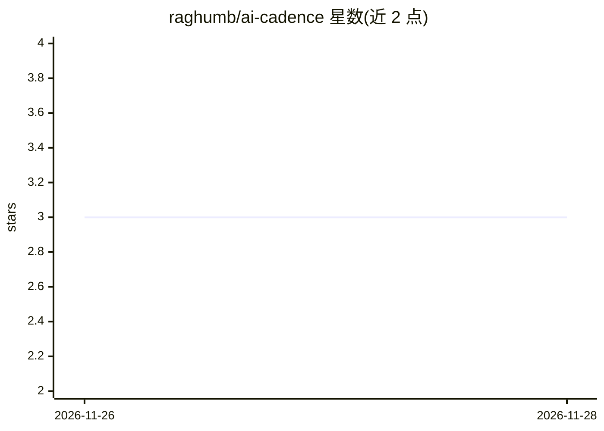

# raghumb/ai-cadence

⭐ 3 · MIT · 推送 2026-11-27 · [GitHub](https://github.com/raghumb/ai-cadence) · 个人维护

**面向开发者的 AI 生态动态人工策展清单/通讯**

开源的 AI 生态动态策展出版物：按 AI 模型、AI 工具、Agent 框架、AI 基础设施、AI 工程、研究与安全治理等行业分类，以倒序时间线发布条目，旧条目按年度归档。定位是提供精要更新，说明变化内容、意义与延伸阅读，而非新闻聚合。面向开发者、架构师、研究人员与技术爱好者。无安装或运行内容，仓库仅含出版物、归档与索引文档。

## 筛选速览

| 维度 | 判定 | 备注 |
|---|---|---|
| AI 角色 | `ai-knowledge` | 知识聚合/清单类 |
| 许可风险 | `permissive` | MIT |
| 部署形态 | `None` |  |
| 模型依赖 | — | README 未给出锁定关系 |
| 硬件要求 | — | 无带数字的原话,不猜 |
| 安装摩擦 | `low` | 无编译、无系统依赖或容器化 |
| 成熟度 | — | 结构信号不足 |

## 能力要点

- 8 个领域分类组织 AI 生态动态（模型/工具/Agent/基础设施等）
- 倒序时间线维护最新条目，旧条目按年度归档并保留来源引用
- 声明策展原则：来源驱动、区分实际能力与营销宣传

## 适用场景

- 跟踪 AI 模型与 Agent 框架的新进展
- 查找值得了解的开源 AI 项目与研究论文
- 按年份浏览 AI 生态发展历史档案

## 场景标签

`精选清单` · 领域:学习与行业

## 证据(README 行号)

> L9: 'AI Cadence' is an open-source initiative that explores significant developments across the Artificial Intelligence 
> L11: From foundation models and AI tools to agent frameworks, infrastructure, research, and emerging innovations, 'AI Ca
> L41: Through hand-curated developments across the AI ecosystem, the aim is to broaden awareness, uncover emerging ideas,

## 星数曲线

2026-11-26 3 → 2026-11-28 3（+0）

---
*卡片 v1 · prompt 1.4 · 生成 2026-11-26 · 置信度 high · 依据 README sha `b82b5ec93650` · [字段定义](../../DATASET.md)*
