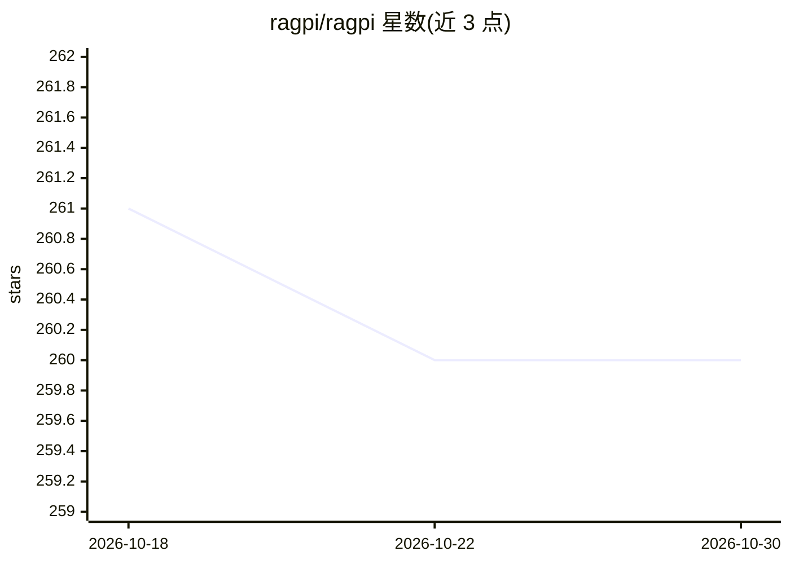

# ragpi/ragpi

⭐ 260 · Python · MIT · 推送 2026-08-08 · [GitHub](https://github.com/ragpi/ragpi) · [官网](https://docs.ragpi.io) · 组织维护

**基于自有文档构建知识库并生成回答的开源 AI 助手**

以 API 优先方式提供的文档问答助手：通过 Sitemap、GitHub Issues/README/PDF、REST API 等连接器同步文档构建知识库，采用 Agentic RAG 进行动态检索，经 /chat 端点生成有文档依据的回答。支持 OpenAI（默认）、Ollama、Deepseek 及 OpenAI 兼容 API 作为模型与嵌入提供方，向量存储支持 Postgres/pgvector 与 Redis，内置 Discord、Slack 集成与可嵌入网站的 Web Widget，以 Docker 部署。限制：更换嵌入模型需手动重新嵌入，无自动数据迁移。

## 筛选速览

| 维度 | 判定 | 备注 |
|---|---|---|
| AI 角色 | `ai-native` | 本体是模型或模型工具 |
| 许可风险 | `permissive` | MIT |
| 部署形态 | `self-host` | docker 或自建部署 |
| 模型依赖 | local-ok | 支持本地模型 |
| 硬件要求 | — | 无带数字的原话,不猜 |
| 安装摩擦 | `low` | 无编译、无系统依赖或容器化 |
| 成熟度 | — | 结构信号不足 |

## 能力要点

- Agentic RAG 动态检索，从文档/Issues/README 构建知识库
- 支持 OpenAI、Ollama、Deepseek 与 OpenAI 兼容 API 作为模型与嵌入提供方
- Postgres/pgvector 与 Redis 双向量存储，高维下构建半精度 HNSW 索引并两阶段查询
- Discord、Slack 集成与可嵌入网站的 Web Widget

## 适用场景

- 为开源项目文档搭建自动问答助手
- 在 Discord/Slack 社区中回答成员的文档问题
- 在网站嵌入文档问答挂件

## 场景标签

`文档问答` `RAG` · 领域:知识与检索

## 证据(README 行号)

> L3: Ragpi is an open-source AI assistant that answers questions using your documentation, GitHub issues, and READMEs. It
> L39: - Use the `/chat` endpoint to query the AI assistant using the configured sources:

## 星数曲线

2026-10-18 261 → 2026-10-30 260（-1）

---
*卡片 v1 · prompt 1.4 · 生成 2026-10-22 · 置信度 high · 依据 README sha `cf80e4c3d1e5` · [字段定义](../../DATASET.md)*
