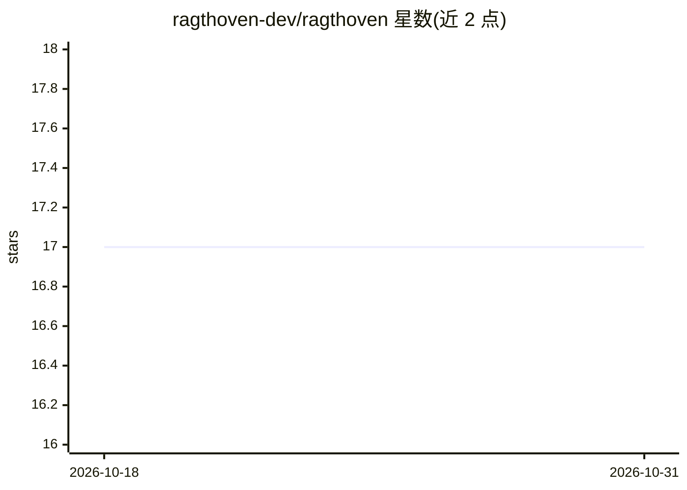

# ragthoven-dev/ragthoven

⭐ 17 · Python · MIT · 推送 2026-03-03 · [GitHub](https://github.com/ragthoven-dev/ragthoven) · 个人维护

**面向研究者的 RAG 实验工具包：YAML/CLI 配置并批量评测**

Python 编写的检索增强生成（RAG）实验工具包，面向需要开展 RAG 评测的研究者与开发者。用户通过 YAML 或 CLI 配置索引、检索（Chroma 向量库、sbert/CDE 嵌入）、重排（FlashRank）与 LLM 生成，在 HuggingFace/csv/tsv/json 数据集上运行端到端实验。支持 matrixable 参数定义多组流水线组合批量评测、多 prompt（jinja2 模板）、断点续跑缓存与 jsonl/csv/tsv 结果输出。通过环境变量接入 OpenAI API 或本地 ollama，使用 poetry 安装，从源码运行，无 Docker 说明。

## 筛选速览

| 维度 | 判定 | 备注 |
|---|---|---|
| AI 角色 | `ai-ecosystem` | LLM/agent 周边工具 |
| 许可风险 | `permissive` | MIT |
| 部署形态 | `None` |  |
| 模型依赖 | local-ok | 支持本地模型 |
| 硬件要求 | — | 无带数字的原话,不猜 |
| 安装摩擦 | `medium` | 含编译或系统依赖之一 |
| 成熟度 | — | 结构信号不足 |

## 能力要点

- YAML/CLI 配置完整 RAG 流水线（检索、重排、生成）
- matrixable 参数批量运行多组配置组合
- 支持缓存续跑，崩溃后仅补算未完成样本
- jinja2 多 prompt 模板，可访问 examples 与数据集特征

## 适用场景

- 在标准数据集上批量评测不同检索/重排/LLM 配置组合
- 复现学术论文中的 RAG 评测流程
- 文本分类、摘要等 NLP 任务的 RAG 基准实验

## 场景标签

`RAG` `模型评测` · 领域:评测与运维

## 证据(README 行号)

> L16: - 🚀 Run end-to-end retrieval-augmented generation (RAG) experiments with minimal setup.
> L21: - 📈 Automate benchmarking for consistent and reproducible RAG-based evaluations.
> L53: 1. Set up the LLM by setting the correct environment variables.

## 星数曲线

2026-10-18 17 → 2026-10-31 17（+0）

---
*卡片 v1 · prompt 1.4 · 生成 2026-10-29 · 置信度 high · 依据 README sha `7ceee50fd6a8` · [字段定义](../../DATASET.md)*
