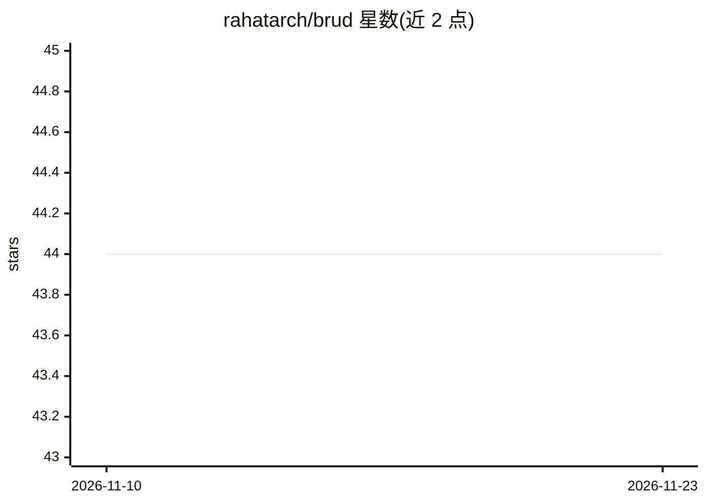

# rahatarch/brud

⭐ 44 · TypeScript · Apache-2.0 · 推送 2026-11-22 · [GitHub](https://github.com/rahatarch/brud) · 组织维护

**面向自主 agent 的可嵌入式零信任微内核运行时**

Brud OS 是一个以 npm 包 @brud/os 分发的 TypeScript 嵌入式运行时，为自主 agent 软件提供零信任控制面：核心引擎自身不含文件 I/O、终端执行或状态等能力，功能以可拆卸服务形式存在；第三方工具运行于无宿主系统访问权的 WebAssembly 沙箱，参与者身份由字节码哈希派生的内核令牌验证，子代理权限被约束为父级能力子集。面向在自有应用中嵌入安全 agent 能力的开发者，需 Node.js >= 20，当前处于 Developer Preview，v1.0 前可能出现破坏性变更。

## 筛选速览

| 维度 | 判定 | 备注 |
|---|---|---|
| AI 角色 | `ai-ecosystem` | LLM/agent 周边工具 |
| 许可风险 | `permissive` | Apache-2.0 |
| 部署形态 | `library` | 以包/库形式分发 |
| 模型依赖 | — | README 未给出锁定关系 |
| 硬件要求 | — | 无带数字的原话,不猜 |
| 安装摩擦 | `low` | 无编译、无系统依赖或容器化 |
| 成熟度 | `idea` | |

## 能力要点

- 零内置能力的微内核：功能以可拆卸模块服务形式提供
- WebAssembly 虚拟指令沙箱隔离第三方工具，无宿主环境权限
- 基于字节码哈希的密码学身份验证与令牌机制
- 能力衰减：子代理权限严格限定为父级能力子集

## 适用场景

- 在自己的应用中嵌入带安全边界的自主 agent 能力
- 隔离运行不可信第三方 agent 工具与插件
- 需要轻量沙箱方案、不依赖重型容器或虚拟机的场景

## 场景标签

`Agent 框架` · 领域:Agent 开发

## 证据(README 行号)

> L7: **The embedded microkernel runtime for autonomous agent software.**
> L13: Brud OS provides an embeddable, zero-trust microkernel substrate. The core engine holds zero built-in capabilities:

## 星数曲线

2026-11-10 44 → 2026-11-23 44（+0）

---
*卡片 v1 · prompt 1.4 · 生成 2026-11-18 · 置信度 high · 依据 README sha `84c0c4d2032d` · [字段定义](../../DATASET.md)*
