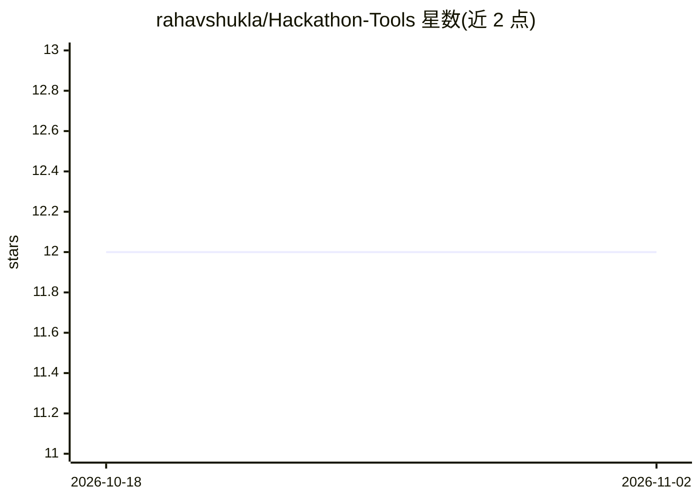

# rahavshukla/Hackathon-Tools

⭐ 12 · 推送 2026-10-12 · [GitHub](https://github.com/rahavshukla/Hackathon-Tools) · 个人维护

**黑客马拉松工具清单：覆盖路演、设计到部署的 35+ 工具**

以 README 形式策展的黑客马拉松工具与框架清单，收录 35+ 条目，按路演展示、UI/UX 与原型等类别组织，条目以简介形式列举（如 Napkin、Canva、Figma、Tailwind CSS 等）。同时 README 描述了一个可从 Releases 页下载的跨平台应用程序及其安装步骤，并列出系统要求（4 GB 内存、500 MB 磁盘）。部分条目链接指向仓库内的 zip 文件。接受社区通过 issue 提交条目建议。

## 筛选速览

| 维度 | 判定 | 备注 |
|---|---|---|
| AI 角色 | `ai-knowledge` | 知识聚合/清单类 |
| 许可风险 | `none` | — |
| 部署形态 | `desktop` | 安装包/桌面程序 |
| 模型依赖 | — | README 未给出锁定关系 |
| 硬件要求 | — | 无带数字的原话,不猜 |
| 安装摩擦 | `low` | 无编译、无系统依赖或容器化 |
| 成熟度 | — | 结构信号不足 |

## 能力要点

- 收录 35+ 工具，按路演/设计等阶段分类
- 描述 Releases 页提供的 Windows/macOS/Linux 下载安装流程
- 列出系统要求：4 GB 内存、500 MB 磁盘、稳定网络
- 通过 issue 接受社区条目贡献

## 适用场景

- 参赛前按阶段查找路演与设计工具
- 了解黑客马拉松从构思到部署的工具覆盖面
- 为团队协作选题与原型设计工具

## 场景标签

`精选清单` · 领域:学习与行业

## 证据(README 行号)

> L7: Hackathon-Tools offers a curated collection of over 35 tools, websites, and frameworks designed to help you succeed 
> L30: To get started with Hackathon-Tools, visit the Releases page to download the latest version. Once there, find the m

## 星数曲线

2026-10-18 12 → 2026-11-02 12（+0）

---
*卡片 v1 · prompt 1.4 · 生成 2026-11-01 · 置信度 mid · 依据 README sha `6f2e8cd762da` · [字段定义](../../DATASET.md)*
