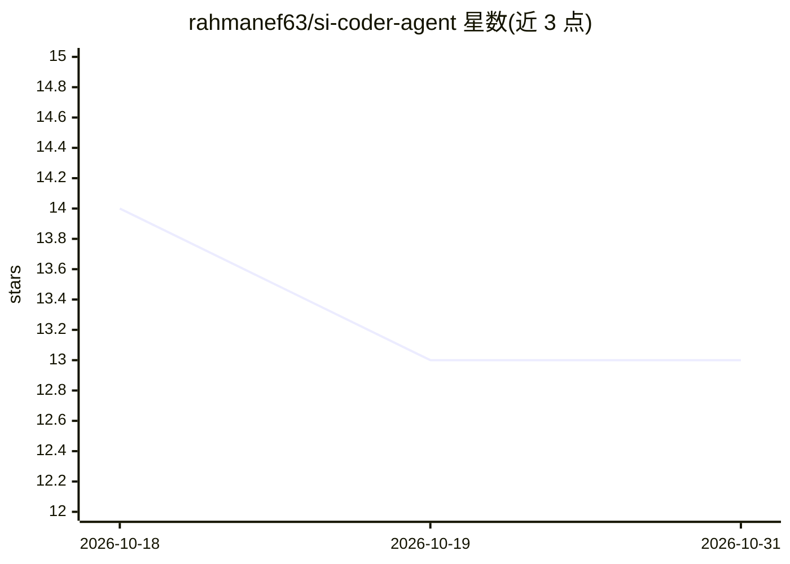

# rahmanef63/si-coder-agent

⭐ 13 · JavaScript · MIT · 推送 2026-10-30 · [GitHub](https://github.com/rahmanef63/si-coder-agent) · 个人维护

**给 AI 编码 agent 的一体化全栈构建/部署技能包（/sc 命令集）**

面向 Claude Code、ChatGPT、Codex 等 AI agent 宿主的技能包与 CLI：以单一 /sc 命令覆盖从自然语言目标到构建、连接服务、发布、域名与线上验证的全流程，对接 GitHub、Convex、Dokploy、Vercel、Hostinger DNS。提供用户/连接/凭据/技能的 CRUD 资源管理（0600 本地存储、明文读取禁用）、多用户隔离、sc flow 单调用多提供商编排（并行 DAG）。安装方式按宿主不同：Claude Code 插件市场或 SKILL.md 目录、Claude Web 用 ZIP。要求 Node ≥18，无运行时依赖；含 8 个已实现技能与 5 个 stub。

## 筛选速览

| 维度 | 判定 | 备注 |
|---|---|---|
| AI 角色 | `ai-ecosystem` | LLM/agent 周边工具 |
| 许可风险 | `permissive` | MIT |
| 部署形态 | `desktop` | 安装包/桌面程序 |
| 模型依赖 | — | README 未给出锁定关系 |
| 硬件要求 | — | 无带数字的原话,不猜 |
| 安装摩擦 | `low` | 无编译、无系统依赖或容器化 |
| 成熟度 | — | 结构信号不足 |

## 能力要点

- 单一 /sc/@sc/sc CLI 契约跨多个 agent 宿主（Claude、ChatGPT、Codex 等）
- 凭据存于本地 user/connection store（0600），agent 只获得状态不获得明文
- sc flow 将多提供商步骤合并为一次调用（并行 DAG、递归子流）
- 技能 CRUD 与模糊多词元检索（sc skills），支持项目级与全局级技能

## 适用场景

- 让 AI 编码 agent 从一句自然语言目标完成构建到上线验证
- 在聊天中安全配置各服务的凭据而不粘贴明文
- 为多客户/多项目隔离管理用户与命名连接
- 创建并复用项目专属的 /sc-* 工作流技能

## 场景标签

`编码 Agent` · 领域:编码与开发

## 证据(README 行号)

> L5: **SC is a tool for AI agents — not another platform to learn.**
> L13: Most agent stacks force you to juggle prompts, secrets, providers, deploy scripts, and ten tool calls per change. S
> L47: - **Host-portable** — Claude, ChatGPT, Codex, Hermes, OpenClaw, local CLI; same intent.

## 星数曲线

2026-10-18 14 → 2026-10-31 13（-1）

---
*卡片 v1 · prompt 1.4 · 生成 2026-10-31 · 置信度 high · 依据 README sha `d935467c6d93` · [字段定义](../../DATASET.md)*
