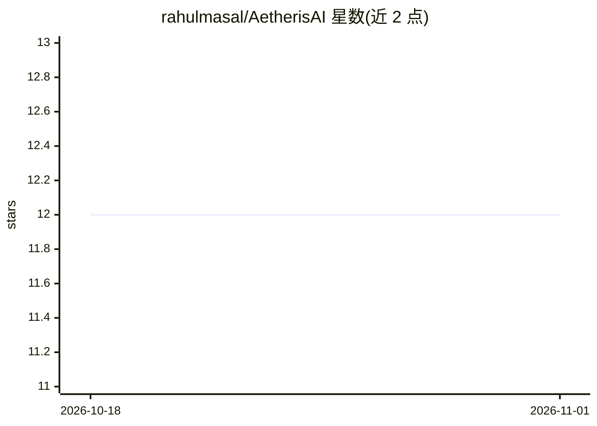

# rahulmasal/AetherisAI

⭐ 12 · Kotlin · 推送 2026-05-23 · [GitHub](https://github.com/rahulmasal/AetherisAI) · 个人维护

**Android 原生多模型 LLM 聊天客户端，自带密钥直连各家 API**

基于 Kotlin 2.1 与 Jetpack Compose/Material 3 的原生 Android 聊天应用，面向自带 API key 的终端用户：内置支持 OpenAI、Anthropic、Groq、OpenRouter，并可添加任意数量的自定义 provider（Ollama、vLLM、LM Studio、私有网关等，兼容 OpenAI 或 Anthropic API 风格）。核心机制包括 SSE 流式响应、通过 GET /v1/models 的模型目录发现、EncryptedSharedPreferences（AES-256-GCM、硬件 MasterKey）加密存储密钥、Room 持久化会话。无账号、无服务器、无遥测。需自行用 Gradle/Android Studio 构建，README 的截图占位尚未填入。

## 筛选速览

| 维度 | 判定 | 备注 |
|---|---|---|
| AI 角色 | `ai-native` | 本体是模型或模型工具 |
| 许可风险 | `none` | — |
| 部署形态 | `None` |  |
| 模型依赖 | local-ok | 支持本地模型 |
| 硬件要求 | — | 无带数字的原话,不猜 |
| 安装摩擦 | `medium` | 含编译或系统依赖之一 |
| 成熟度 | — | 结构信号不足 |

## 能力要点

- 多 provider 支持：OpenAI/Anthropic/Groq/OpenRouter + 无限自定义 provider
- 通过 GET /v1/models 实时发现并缓存模型目录，可手动添加与置顶模型
- API 密钥 AES-256-GCM 加密存储于设备，不参与云备份
- SSE 流式响应，兼容 OpenAI [DONE] 与 Anthropic 事件两种格式

## 适用场景

- 在手机上用同一个应用切换不同厂商的模型对话
- 自备密钥直连 Ollama/vLLM 等私有或本地网关端点
- 多会话管理，每会话独立选择模型与 system prompt

## 场景标签

`聊天机器人` · 领域:对话与助手

## 证据(README 行号)

> L5: A beautiful, fast, fully native **Android chat client** for OpenAI, Anthropic, Groq, OpenRouter, and any OpenAI-comp
> L15: Most chat apps lock you into one provider. **Aetheris** lets you talk to *every* major LLM — switch models mid-conv

## 星数曲线

2026-10-18 12 → 2026-11-01 12（+0）

---
*卡片 v1 · prompt 1.4 · 生成 2026-11-01 · 置信度 high · 依据 README sha `b511362ee6bf` · [字段定义](../../DATASET.md)*
