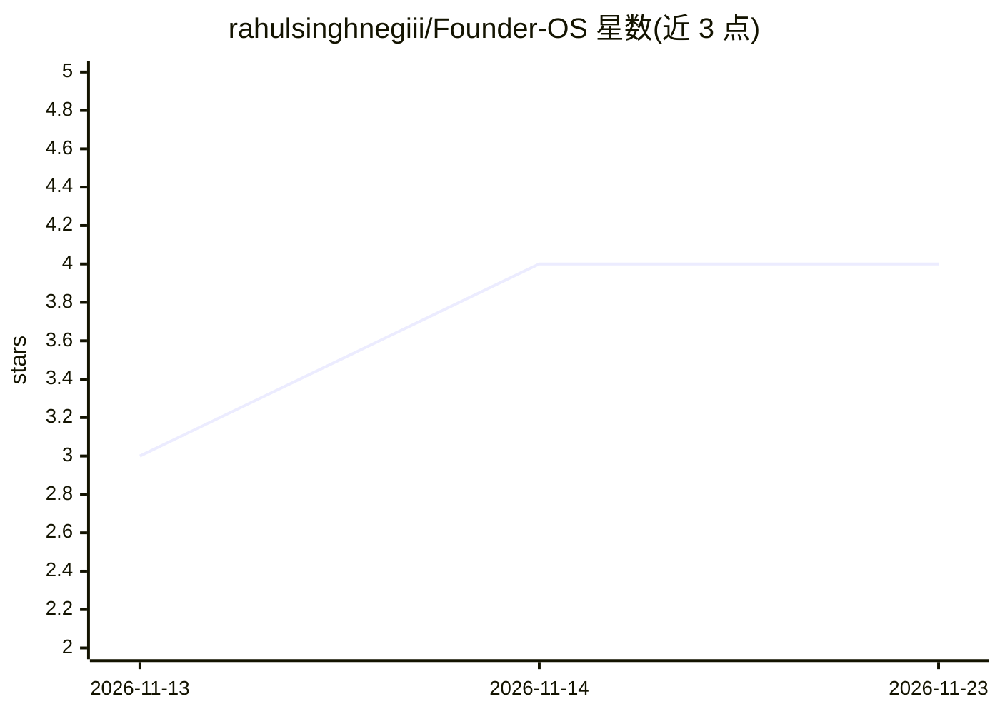

# rahulsinghnegiii/Founder-OS

⭐ 4 · TypeScript · MIT · 推送 2026-10-19 · [GitHub](https://github.com/rahulsinghnegiii/Founder-OS) · 个人维护

**面向独立创始人的自托管 AI 销售助手：识别沉默商机并起草跟进邮件**

自托管销售管道工具：按商机阶段设置沉默时限，定时扫描标记久未跟进的商机并给出风险等级；Sales agent 从商机备注生成跟进邮件草稿，用户自行发送后重置计时。支持 0-100 线索评分、每日管道简报、可选 Gmail 头部同步（不读正文）。通过内置 MCP 服务器接入 ChatGPT/Claude/Cursor 等客户端直接查询和操作管道。数据存于自建 Postgres；无 AI key 时回退到模板草稿和规则简报。MIT 许可，Docker Compose 一条命令启动。

## 筛选速览

| 维度 | 判定 | 备注 |
|---|---|---|
| AI 角色 | `ai-native` | 本体是模型或模型工具 |
| 许可风险 | `permissive` | MIT |
| 部署形态 | `self-host` | docker 或自建部署 |
| 模型依赖 | local-ok | 支持本地模型 |
| 硬件要求 | — | 无带数字的原话,不猜 |
| 安装摩擦 | `low` | 无编译、无系统依赖或容器化 |
| 成熟度 | — | 结构信号不足 |

## 能力要点

- 按阶段沉默时限的 stale-deal 检测，超限时标记、双倍时标记 critical
- Sales agent 从商机上下文起草跟进邮件；本产品自身不发送邮件
- 内置 MCP 服务器，提供 search/fetch 及 founderos_* 系列工具供 MCP 客户端调用
- 无 AI key 时以模板草稿与规则简报继续运行

## 适用场景

- 一人公司追踪哪些商机久未跟进并补发跟进邮件
- 在 ChatGPT 或 Claude 里直接查询和更新自己的销售管道
- 只读 Gmail 邮件头自动维护各商机的最近联系时间

## 场景标签

 · 领域:销售/CRM 工具

## 证据(README 行号)

> L12: **FounderOS watches your sales pipeline, flags the deals that have gone quiet, and drafts the follow-up email for y
> L14: It is a self-hosted, open-source alternative to a full CRM like HubSpot or Pipedrive, built for one-person companie
> L31: - **Works inside ChatGPT and Claude.** A built-in MCP server lets ChatGPT, Claude, Cursor, or any MCP client read y

## 星数曲线

2026-11-13 3 → 2026-11-23 4（+1）

---
*卡片 v1 · prompt 1.4 · 生成 2026-11-21 · 置信度 mid · 依据 README sha `db6ca8e34007` · [字段定义](../../DATASET.md)*
